# M4 Exploratory Data Analytics Report

**Project:** DataCo Supply Chain Dataset EDA  
**Milestone:** M4 - Exploratory Data Analytics Report  
**Companion notebook:** `INFO371-Class2-Group8-M4_EDA.ipynb`

---

## Table of Contents

1. [Introduction and Data Preparation](#1-introduction-and-data-preparation)
2. [Sales Performance and Product Demand](#2-sales-performance-and-product-demand)
3. [Market and Regional Performance](#3-market-and-regional-performance)
4. [Delivery and Operational Risk](#4-delivery-and-operational-risk)
5. [Profitability and Loss Analysis](#5-profitability-and-loss-analysis)
6. [Fraud Risk Exploration](#6-fraud-risk-exploration)
7. [Customer Segmentation](#7-customer-segmentation)
8. [Revised Hypotheses and Modelling Question](#8-revised-hypotheses-and-modelling-question)

---

## 1. Introduction and Data Preparation

This report summarizes the exploratory data analysis for the DataCo supply chain dataset. The goal is to understand sales performance, product demand, geographic differences, delivery risk, suspected fraud patterns, profitability, and customer segmentation before moving into the modelling milestone.

The team's original hypotheses were:

1. Product-driven businesses show significant variation across product categories, so product features should have a strong impact on sales.
2. Sales may exhibit seasonal distribution over time.
3. Transfer-payment security is relatively weak, and fraud may be related to payment methods.
4. Western Europe and Central America may be high-fraud areas.
5. Fraud rate may be related to the economic level of geographic regions and payment methods.

The notebook keeps the original preprocessing workflow. The raw dataset is loaded from `DataCoSupplyChainDataset.csv`, column names are standardized, date fields are converted to datetime format, records after `2017-10-01` are filtered out, high-missingness or sensitive columns are removed, and date-derived fields are created. Key derived fields include `ORDER_YEAR`, `ORDER_MONTH`, `ORDER_DAY`, `ORDER_WEEKDAY`, and `ORDER_DATE`.

The analysis is conducted at the order-item level unless a chart explicitly aggregates to product, customer, market, or region level. Sales outliers are retained because they represent real high-value transactions. Removing them would make some visualisations cleaner, but it would reduce the authenticity of the business data and hide important high-value sales behavior.

---

## 2. Sales Performance and Product Demand

This section explores the main outcome that the team plans to model: `sales`. It focuses on sales distribution, high-volume products, sales timing, and product demand variation.

### 2.1 Sales Distribution and Outliers

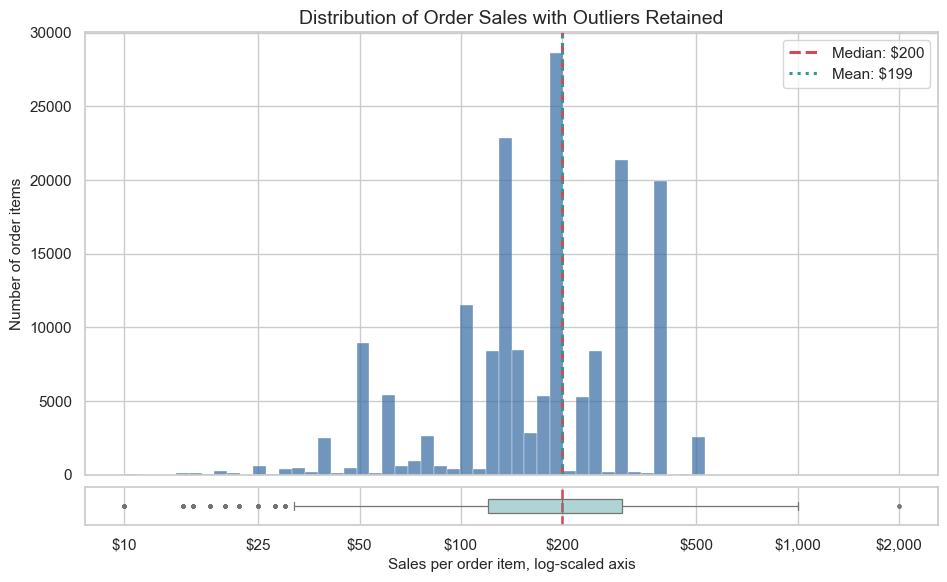

**takeaway:** The full sales range is retained and shown on a log-scaled x-axis so the concentration of typical orders and the high-value tail can be seen together. The median is marked with a dashed red line. Most orders cluster in the lower-to-middle sales range, while fewer high-value orders extend the right tail. These outliers are not removed because they represent real high-value business orders.

### 2.2 Top Products by Quantity Sold

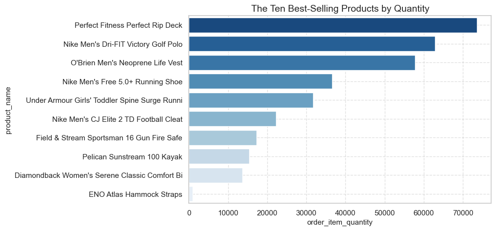

**takeaway:** A small number of products account for the highest quantities sold. This strongly supports the original hypothesis that product identity and category are important for sales performance.

### 2.3 Monthly Sales by Year

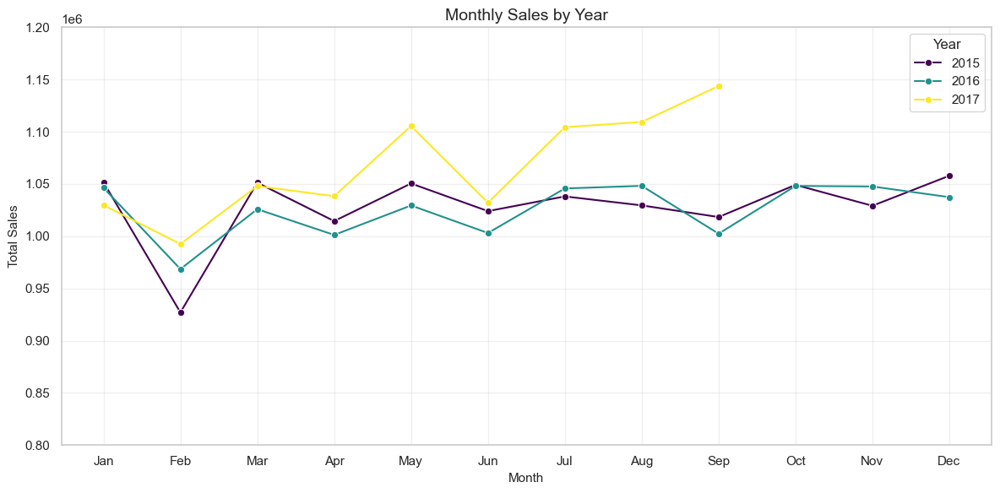

**takeaway:** Monthly sales vary across years and months instead of staying flat. This partially supports the hypothesis that sales may have a time pattern, so `ORDER_MONTH` and `ORDER_YEAR` should remain candidate predictors.

### 2.4 Order Volume by Hour of Day

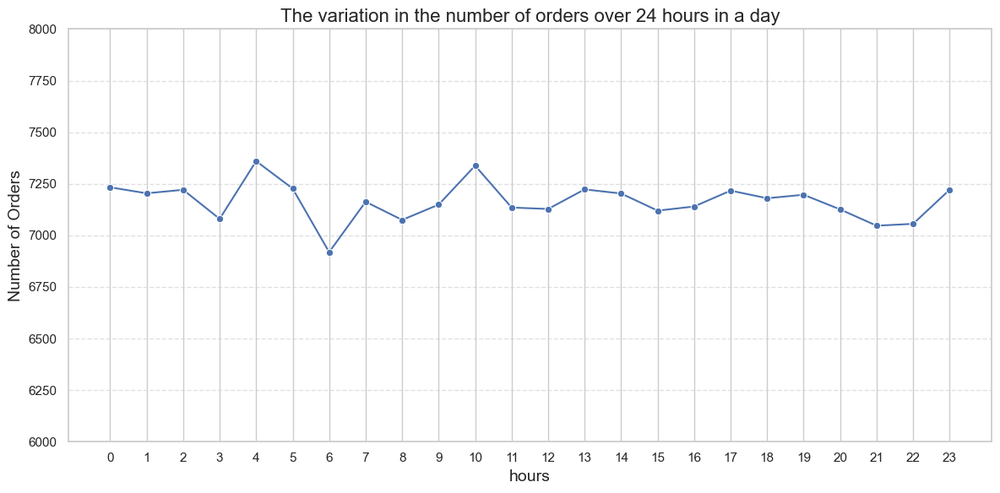

**takeaway:** Order volume changes by hour of day, showing that customer activity is not evenly distributed across the 24-hour cycle. Hour may be useful if the final model includes more detailed time features.

### 2.5 Average Monthly Quantity for Top Products

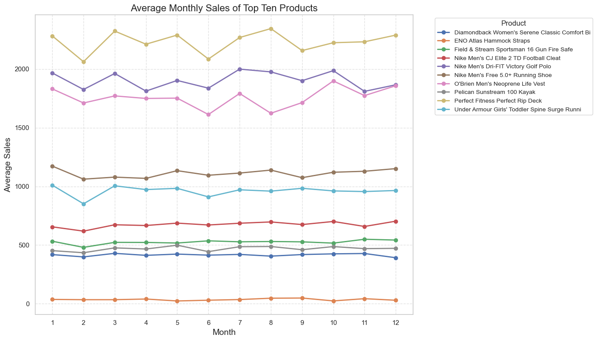

**takeaway:** Top products have different monthly quantity patterns. Product performance is not uniform over time, so product features and time features should be considered together in the sales prediction model.

---

## 3. Market and Regional Performance

This section examines whether geography helps explain variation in sales performance. These variables are important because the existing sales model already uses market and regional fields.

### 3.1 Total Sales by Market

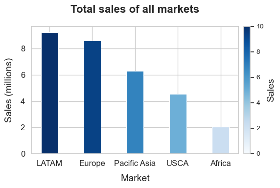

**takeaway:** Sales are concentrated in certain markets rather than being evenly distributed. Market should therefore remain in the modelling feature set because geographic market differences are relevant to sales.

### 3.2 Total Sales by Region

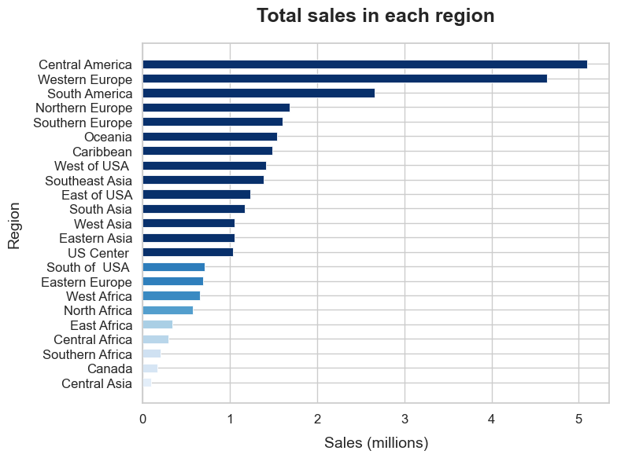

**takeaway:** Sales vary substantially by order region. This suggests that regional demand and market structure may influence sales outcomes.

---

## 4. Delivery and Operational Risk

This section explores late delivery patterns and shipping mode differences. Delivery risk is not the final modelling target, but it provides operational context and may inform future feature engineering.

### 4.1 Late Delivery Rate by Region

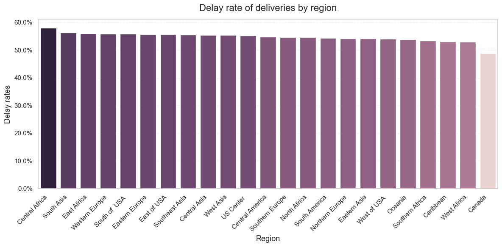

**takeaway:** Late delivery rates differ by region. This introduces an operational risk pattern that was not the main focus of the original hypotheses but is useful business context.

### 4.2 Late Delivery Risk by Shipping Mode and Market

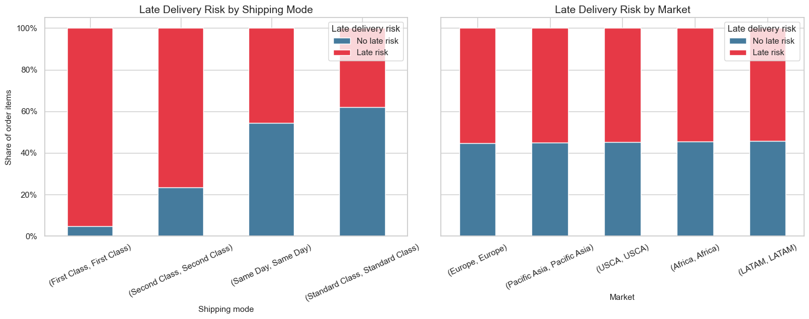

**takeaway:** Late delivery risk changes by both shipping mode and market. This shows that logistics and geography have measurable relationships with operational performance, even though the main model will continue to predict sales.

### 4.3 Late Delivery Rate by Region and Shipping Mode

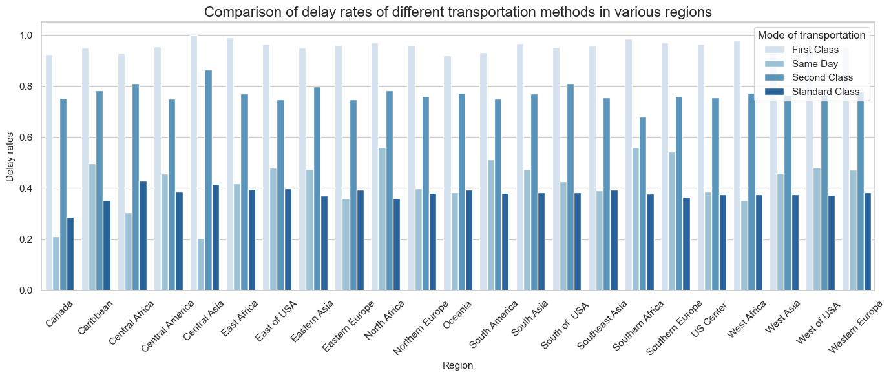

**takeaway:** Late delivery risk changes across both region and shipping mode. This is a multivariate pattern because the relationship between delivery risk and shipping mode depends on region.

### 4.4 Shipping Mode Mix by Market

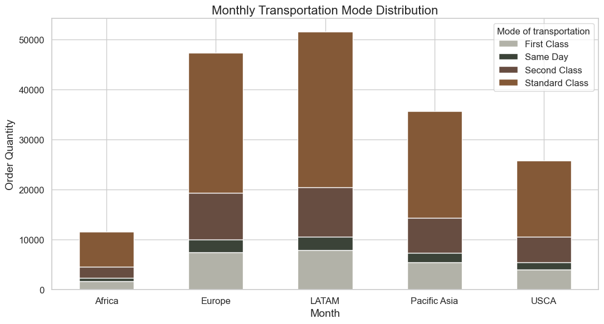

**takeaway:** Markets rely on different mixes of shipping modes. This may partly explain why delivery risk differs across markets and regions.

### 4.5 Late Delivery Rate by Market and Shipping Mode

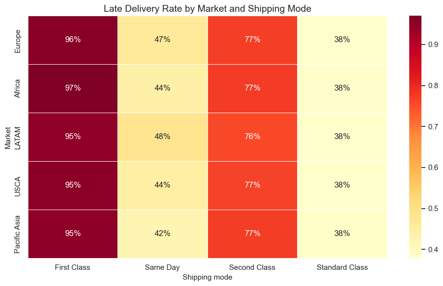

**takeaway:** Late delivery risk depends on the combination of market and shipping mode. This suggests that geographic and logistics variables can interact, which may be useful context for future feature engineering.

---

## 5. Profitability and Loss Analysis

This section examines whether sales volume aligns with business value. It adds context for interpreting sales predictions and highlights cases where revenue alone may be misleading.

### 5.1 Benefit Per Order Distribution

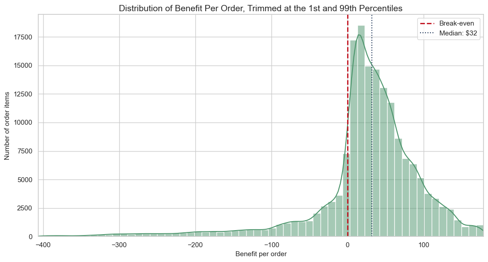

**takeaway:** The benefit distribution shows a visible negative-profit region. A meaningful share of order items falls below zero benefit, so product, region, shipping, and discount variables should be evaluated not only for sales but also for profitability risk.

### 5.2 Loss-Making Product Categories

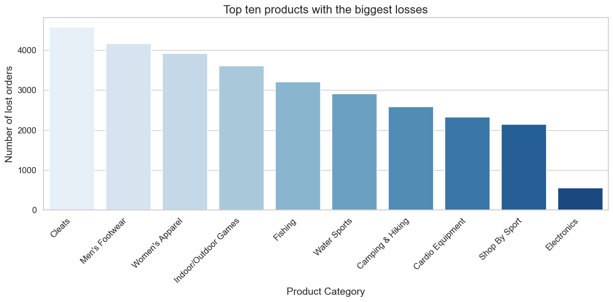

**takeaway:** Loss-making orders are concentrated in particular product categories. Product features affect not only sales volume but also profitability risk.

### 5.3 Sales vs Benefit Per Order

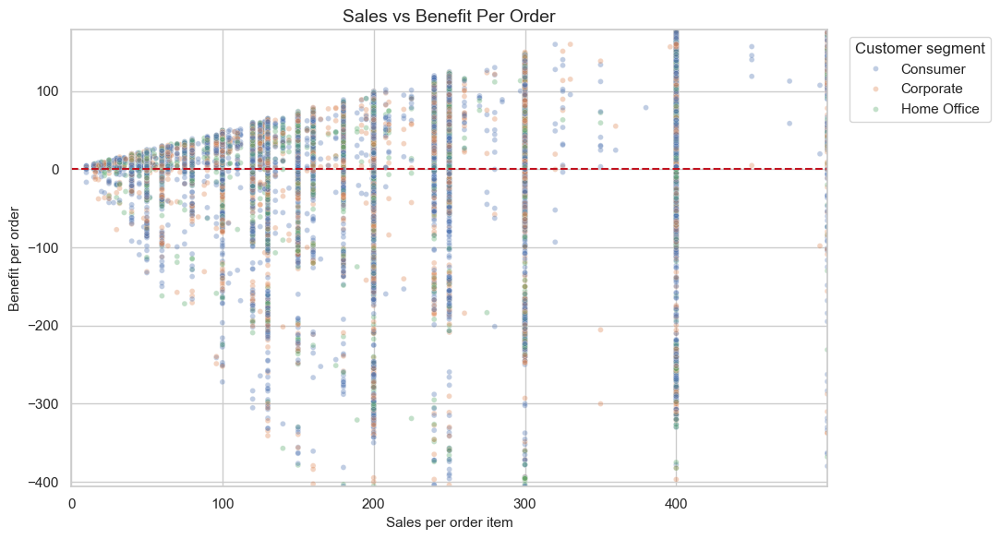

**takeaway:** Sales and benefit are related, but high sales do not always guarantee positive profit. This means the team should avoid treating sales volume as the only business outcome, even if `sales` remains the modelling target.

### 5.4 Loss Rate by Region

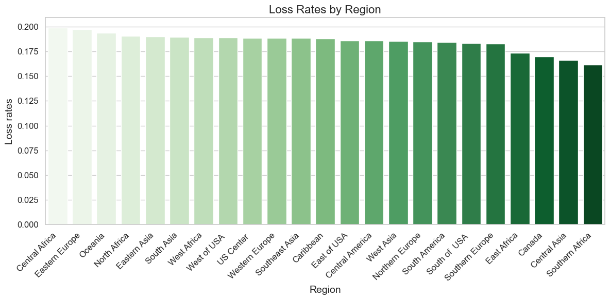

**takeaway:** Loss rates differ across regions, suggesting that regional business conditions, product mix, discounting, or logistics may influence profitability.

### 5.5 Product Category Sales, Profit, and Late Delivery Risk

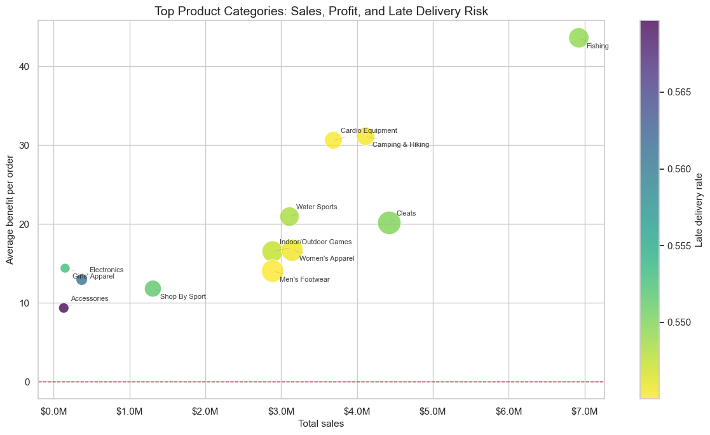

**takeaway:** Product categories differ across total sales, average benefit, order volume, and late delivery risk. This strengthens the conclusion that product features matter, but it also shows that product-level decisions should consider profitability and operational risk.

---

## 6. Fraud Risk Exploration

This section evaluates the team's fraud-related hypotheses. Fraud is treated as business risk context rather than the main modelling target because the next modelling milestone will continue the existing sales regression direction.

### 6.1 Suspected Fraud Distribution by Region

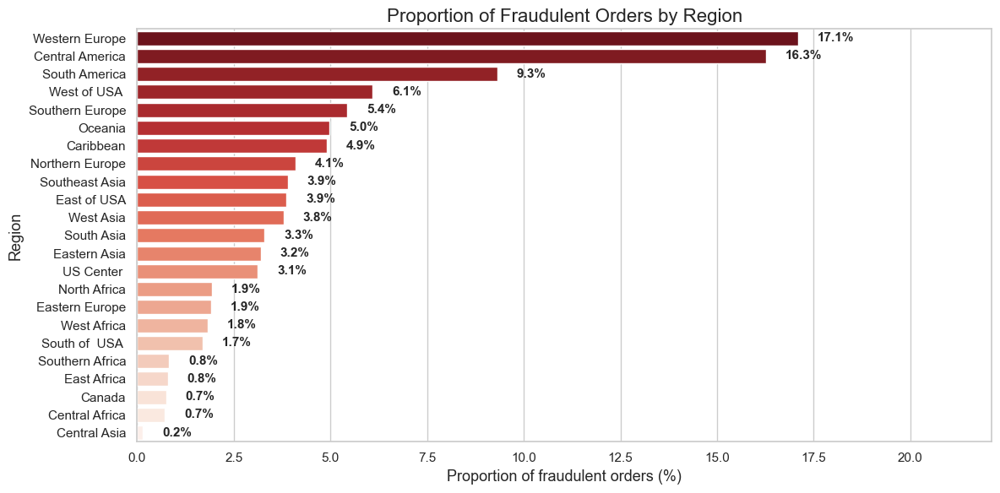

**takeaway:** Suspected fraud orders are not evenly distributed across regions. However, this chart shows distribution among fraud cases, so regional fraud rates should also be checked before concluding that a region is truly high-risk.

### 6.2 Suspected Fraud by Payment Method

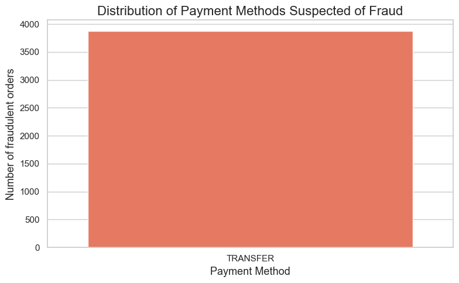

**takeaway:** Suspected fraud cases are concentrated among certain payment types. This partially supports the team's hypothesis that payment method may be related to fraud risk.

### 6.3 Suspected Fraud by Product Category

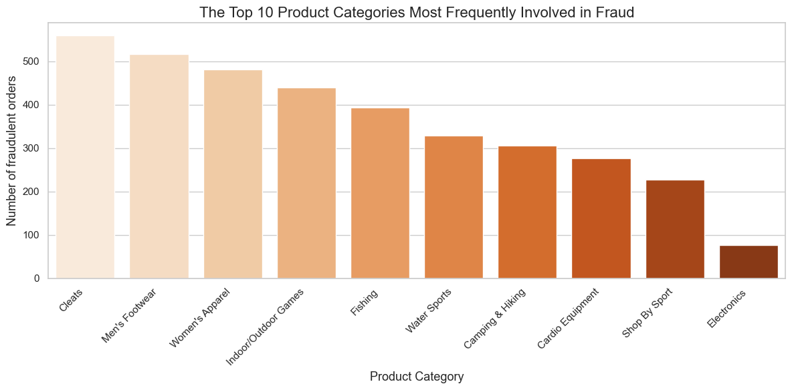

**takeaway:** Some product categories appear more frequently in suspected fraud orders. This suggests fraud risk may be associated with product type, although category-level fraud rates should also be checked because high-volume categories naturally produce more cases.

### 6.4 Customers with the Most Suspected Fraud Cases

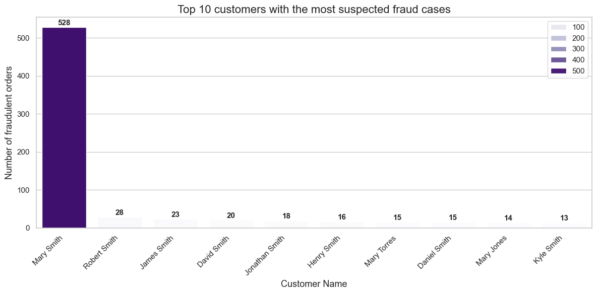

**takeaway:** A few customer names appear more often among suspected fraud cases. This may indicate repeated suspicious activity, but customer-level takeaway should be handled carefully because names may not uniquely identify individuals.

---

## 7. Customer Segmentation

This section uses RFM segmentation to understand customer value groups. These results may support future customer-level feature engineering if segments are constructed without leakage.

### 7.1 RFM Customer Value Pyramid

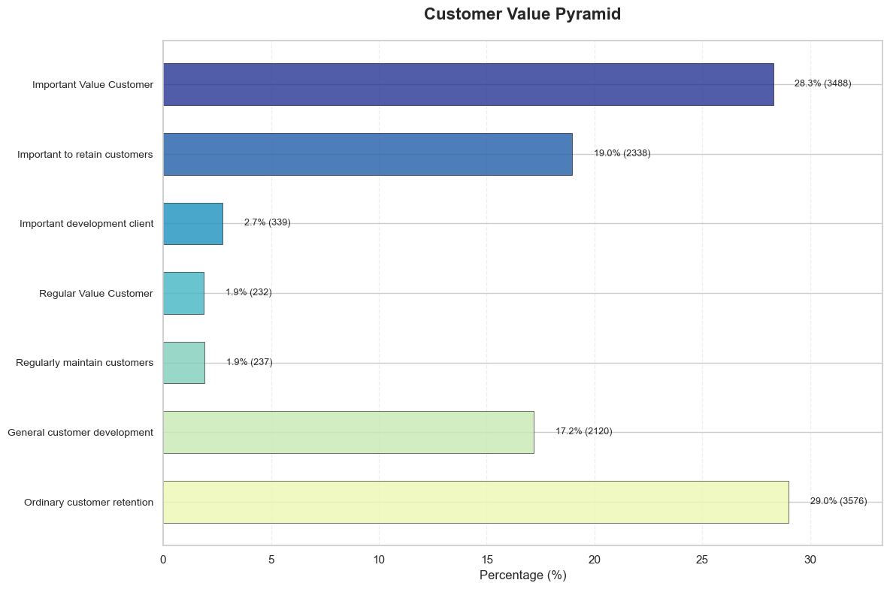

**takeaway:** Customers are distributed unevenly across RFM value groups. This supports using RFM stratification as a descriptive tool and potentially as a feature source in later modelling.

### 7.2 RFM Customer Segment Distribution

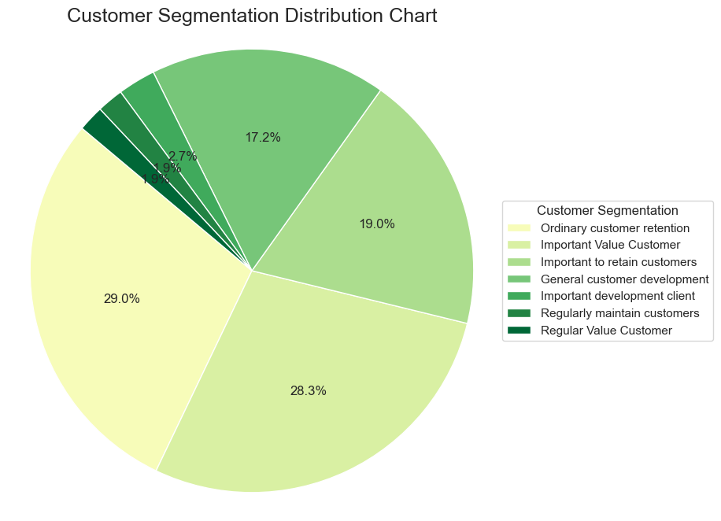

**takeaway:** Customer value groups are imbalanced. RFM segmentation can be used as a descriptive customer lens and may be considered as a future engineered feature if it is created without leakage.

---

## 8. Revised Hypotheses and Modelling Question

### 8.1 Revised Hypotheses

Based on the EDA, the team's original hypotheses should be revised as follows:

1. **Product features have a significant impact on sales: strongly supported.** Product quantity, category performance, and product-specific monthly patterns vary clearly. Product features such as `category_id`, `product_name`, and `order_item_quantity` should remain central to the sales prediction model.

2. **Sales may exhibit seasonal distribution: partially supported.** Monthly sales vary across months and years, and order volume changes by hour. This supports including time variables such as `ORDER_MONTH`, `ORDER_YEAR`, and possibly hour, although formal seasonality would require additional testing.

3. **Fraud may be related to payment methods and geographic regions: partially supported.** Fraud patterns appear by payment type, region, product category, and customer. However, this is better treated as business risk context than as the main modelling target because the existing modelling work focuses on sales regression.

4. **Western Europe and Central America are high-fraud areas: needs rate-based verification.** Fraud counts alone can be misleading because regions have different order volumes. Regional fraud rates should be compared before making a final claim.

5. **Fraud rate may be related to economic level and payment methods: only partly testable.** Payment method can be examined directly, but the dataset does not contain external economic-level indicators. Claims about regional economic level would require additional data.

6. **EDA-driven modelling direction: continue with sales prediction.** Sales differ by product, market, region, order quantity, and time. The most consistent next step is to continue the existing supervised regression approach and refine it using EDA-supported features.

### 8.2 Clear Modelling Question

**Machine learning objective:** Build a supervised regression model that predicts order-item sales using product, customer, geography, quantity, and time-related features identified during EDA.

**Formal modelling question:** Given an order item's product category or product name, customer location, market, order city/country, order region, order quantity, order month, and order year, can we predict the continuous target variable `sales`?

This is a **regression** problem, which aligns with the team's previous modelling work using Linear Regression, Random Forest Regressor, and Gradient Boosting Regressor.

**Target variable:** `sales`.

**Recommended evaluation metrics:** MSE, RMSE, MAE, and R-squared.

**Candidate feature groups:**

- Product features: `category_id`, `product_name`, product category, department
- Geography features: `customer_city`, `customer_country`, `market`, `order_city`, `order_country`, `order_region`
- Order features: `order_item_quantity`, product price, discount variables
- Time features: `ORDER_MONTH`, `ORDER_YEAR`, weekday, hour
- Customer features: customer segment and possible RFM-derived segment

**Connection to the existing model:** The previous model already uses `category_id`, `customer_city`, `customer_country`, `market`, `order_city`, `order_country`, `order_item_quantity`, `order_region`, `product_name`, `ORDER_MONTH`, and `ORDER_YEAR` to predict `sales`. The EDA supports continuing this direction because these variables show meaningful sales variation.

### 8.3 Conclusion

The EDA shows that sales are unevenly distributed across products, markets, regions, and time periods. Product-level charts support the team's original expectation that product features matter for sales, while monthly and hourly patterns suggest that time features may improve prediction. Market and regional charts show geographic variation, and RFM analysis provides a possible customer-level extension for future feature engineering.

Fraud and delivery-risk analyses remain useful business context. Suspected fraud appears related to payment type, region, product category, and customer, while late delivery risk varies by market and shipping mode. However, these findings do not require changing the next modelling target. The recommended next step is to continue with the existing **sales prediction regression** framework and improve it using EDA-supported features.
