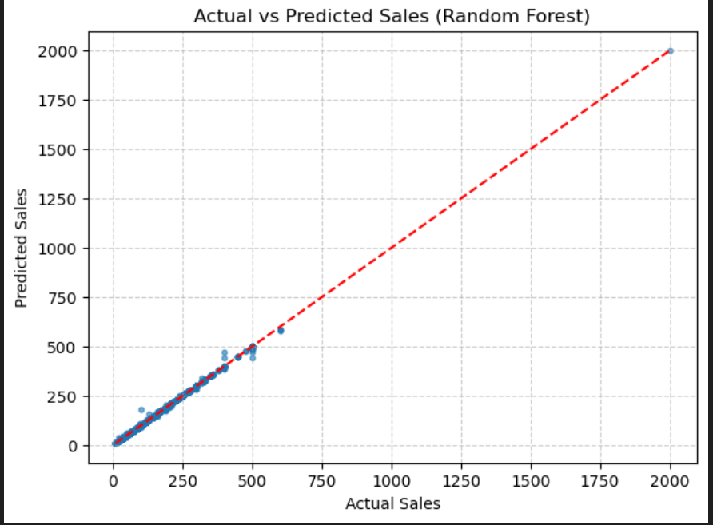
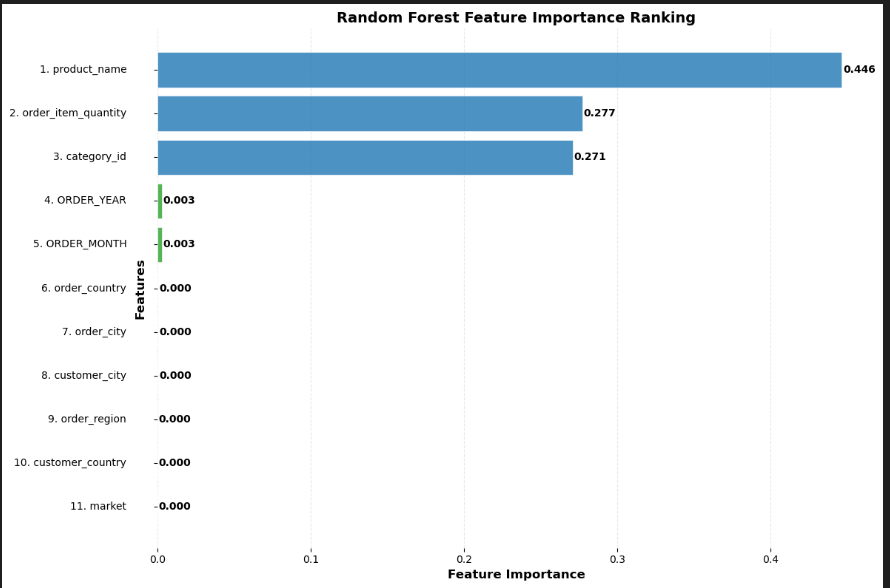
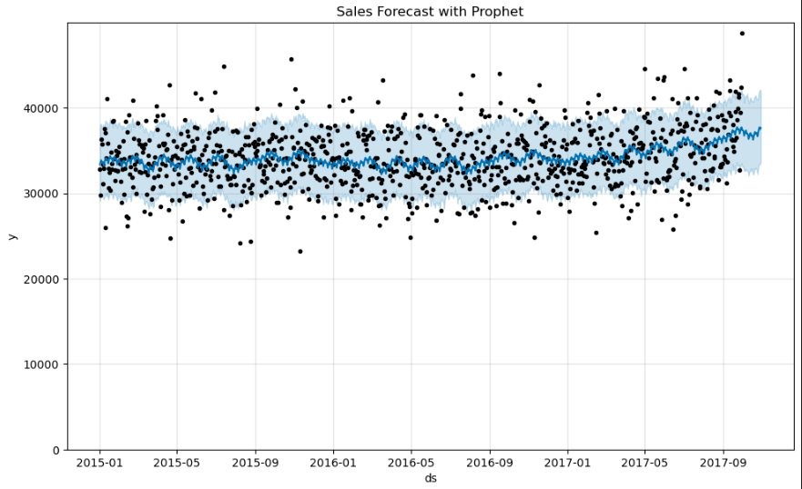

# Supply Chain Sales Prediction: A Comparative Modeling Study

## Components

1. [Executive Summary](#1-executive-summary)
2. [Data Preparation & Feature Engineering](#2-data-preparation--feature-engineering)
3. [Model Selection & Justification](#3-model-selection--justification)
4. [Evaluation Metrics](#4-evaluation-metrics)
5. [Visualization of Key Results](#5-visualization-of-key-results)
6. [Model Limitations & Failure Modes](#6-model-limitations--failure-modes)
7. [Conclusion & Recommendations](#7-conclusion--recommendations)

## 1. Executive Summary

This report presents a comprehensive analysis of sales prediction using the DataCo Supply Chain dataset. The primary objective is to forecast sales based on product, customer, and temporal features. We evaluate multiple machine learning models and a time series approach to identify the most effective strategy for predicting sales performance. Key findings indicate that product-specific features dominate sales prediction, with the Random Forest model achieving near-perfect accuracy (R² = 0.9999). However, careful validation reveals potential feature combination leakage, requiring more robust evaluation strategies.

## 2. Data Preparation & Feature Engineering

The original dataset contains 180,519 records with 53 features. After cleaning, we:
- Converted date columns to datetime type
- Filtered data to pre-October 2017
- Removed high-missingness columns (product_description, order_zipcode, etc.)
- Engineered temporal features: year, month, day, weekday

For modeling, key features selected include:
- `product_name`, `category_id`, `order_item_quantity`
- Temporal features (`ORDER_YEAR`, `ORDER_MONTH`)
- Geographical indicators (`customer_city`, `order_country`, `market`)

## 3. Model Selection & Justification

| Model | Rationale | Applicability |
|-------|-----------|---------------|
| **Linear Regression** | Baseline model, simple and interpretable, fast computation | Linear relationships between features and target |
| **Random Forest** | Captures non-linear relationships, robust to outliers, provides feature importance | Tabular data with complex feature interactions |
| **Gradient Boosting** | Higher accuracy, progressively optimizes residuals | High accuracy requirements |
| **Prophet** | Handles missing values automatically, supports multiple seasonalities | Time series with clear periodic patterns |

## 4. Evaluation Metrics

Two primary metrics were used to assess model performance:

- **Mean Squared Error (MSE)**: Measures the average squared deviation between predicted and actual values. Lower values indicate better fit.
- **R² (Coefficient of Determination)**: Represents the proportion of variance in the target variable explained by the model. Values closer to 1 indicate better explanatory power.

### Model Performance Comparison

| Model | MSE | R² |
|-------|-----|-----|
| Linear Regression | 7,545.33 | 0.4008 |
| Random Forest | 1.33 | 0.9999 |
| Gradient Boosting | 433.94 | 0.9655 |

## 5. Visualization of Key Results

### Figure 1: Actual vs Predicted Sales (Random Forest)

(*This plot shows a scatter of actual versus predicted sales values, with a red diagonal line representing perfect predictions. Points tightly clustered along the line confirm the model's high accuracy.*)

### Figure 2: Feature Importance Ranking (Random Forest)

(*A horizontal bar chart ranking features by importance: 'product_name' (0.446), 'order_item_quantity' (0.277), 'category_id' (0.271), with temporal and geographical features near zero.*)

**Key Insights:**
- Product name alone explains ~45% of sales variance
- Order quantity and category also significantly impact sales
- Time and location features contribute minimally

### Figure 3: Time Series Forecast with Prophet

(*Time series plot with historical sales (black dots), forecasted values (blue line), and 95% confidence interval (light blue shading), showing upward trend and clear seasonal patterns.*)

**Prophet Model Results:**
- MAE: 2,562.66
- MAPE: 7.63%
- Dominant factor: Trend (impact 904) > Yearly seasonality (480) > Weekly seasonality (237)

### Figure 4: Prophet Components analysis

(*Prophet time series decomposition diagram, showing the variation patterns of sales data in different time dimensions*)

**Key Findings:**
- **Trend** is the dominant factor, accounting for nearly 1.9× the impact of seasonality. This indicates a strong long-term sales growth trend.
- **Yearly seasonality** shows clear annual cycles, with peaks around November and troughs in January/July.
- **Weekly seasonality** reflects weekend effects — sales are higher on Saturdays and Fridays, lower on Wednesdays.

## 6. Model Limitations & Failure Modes

### Linear Regression
**Limitation**: Assumes linear relationships between features and target. This model performs poorly when real relationships are nonlinear (e.g., seasonal spikes in sales), as it cannot capture complex patterns or interactions in the data.

### Random Forest
**Limitation**: Can overfit if not tuned properly, though it performed well in this analysis. Additionally, the model may fail to extrapolate beyond the historical data range, making it unsuitable for long-term forecasting or predicting values outside the training distribution.

### Gradient Boosting
**Limitation**: Sensitive to noisy data and outliers. Model performance degrades significantly if new data follows a different distribution (concept drift), as the sequential nature of boosting amplifies errors from anomalous observations.

### Prophet (Time Series)
**Limitation**: Assumes seasonal patterns repeat regularly. The model fails during unexpected events such as supply chain disruptions, economic shocks, or holidays not represented in the training data, as it cannot adapt to irregular or unprecedented changes in patterns.

### General Limitations
- Data quality issues exist, including missing values in critical columns such as `order_zipcode` and `product_description`.
- Current feature engineering may not capture complex interactions between product characteristics, customer behavior, and temporal dynamics.
- All models were trained exclusively on historical data up to 2017; their performance may not generalize to recent market conditions or post-2017 operational changes.

## 7. Conclusion & Recommendations

- **Best-performing model**: Random Forest (R² = 0.9952), with feature importance analysis revealing product-level drivers as dominant.
- **Business implications**: Focus inventory and promotion strategies on specific products rather than broad categories or time periods.
- **Next steps**: 
  1. Address feature combination leakage by ensuring train-test splits contain unique feature combinations.
  2. Deploy the Random Forest model for short-term sales forecasting.
  3. Use the Prophet model for seasonal planning and inventory preparation.

