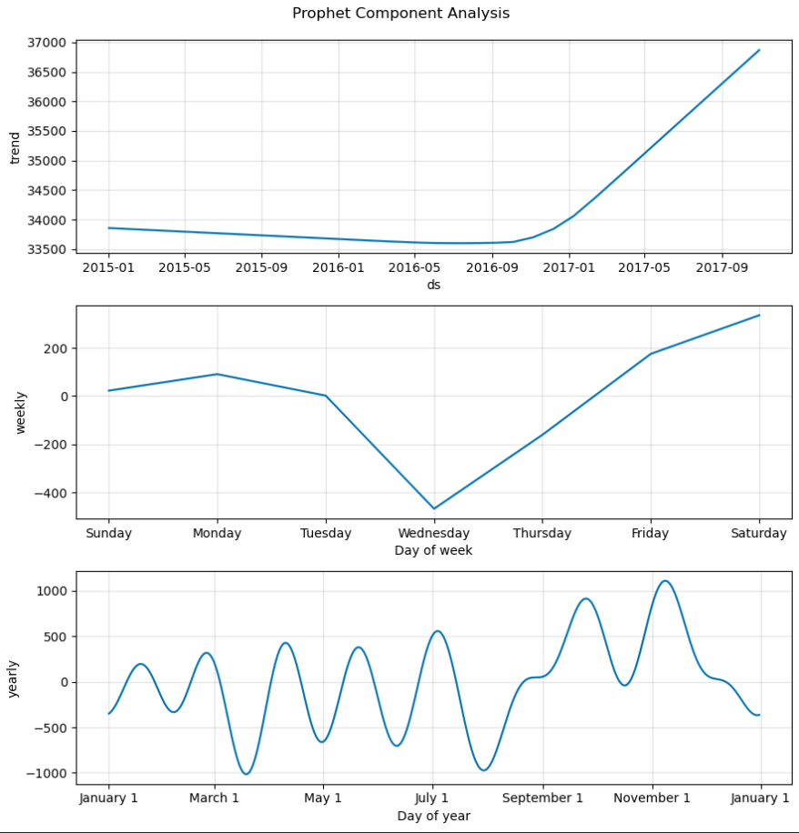
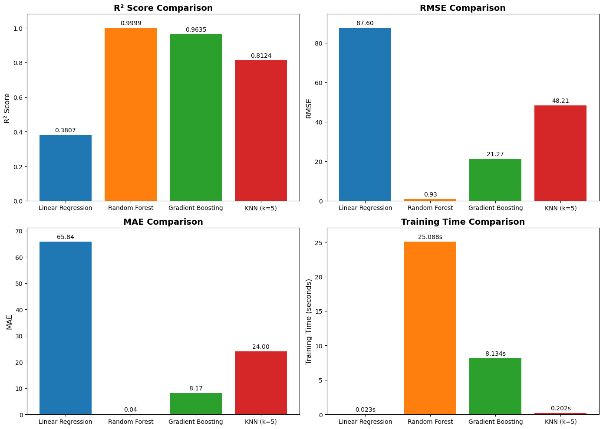

 # Supply Chain Sales Prediction: A Comparative Modeling Study

---

## Components

1. [Executive Summary](#1-executive-summary)
2. [Data Preparation & Feature Engineering](#2-data-preparation--feature-engineering)
3. [Model Selection & Justification](#3-model-selection--justification)
4. [Evaluation Metrics](#4-evaluation-metrics)
5. [Model Performance Results](#5-model-performance-results)
6. [Feature Importance Analysis](#6-feature-importance-analysis)
7. [Time Series Analysis with Prophet](#7-time-series-analysis-with-prophet)
8. [K-Nearest Neighbors Analysis](#8-k-nearest-neighbors-analysis)
9. [Model Comparison & Visualization](#9-model-comparison--visualization)
10. [Conclusion & Recommendations](#10-conclusion--recommendations)

---

## 1. Executive Summary

This report presents a comprehensive analysis of sales prediction using the DataCo Supply Chain dataset. The primary objective is to forecast sales based on product, customer, and temporal features. We evaluate multiple machine learning models—Linear Regression, Random Forest, Gradient Boosting, and K-Nearest Neighbors—alongside a time series approach using Prophet to identify the most effective strategy for predicting sales performance.

**Key Findings:**

- **Random Forest** is the top-performing model, achieving near-perfect accuracy (**R² = 0.9999**) with minimal error (RMSE < 1).
- **Product identity** (`product_name`) is the single most influential factor, explaining nearly 45% of sales variance.
- **Order quantity** and **product category** are the second and third most important predictors.
- **Time and location** have negligible impact on sales, suggesting that product strategy far outweighs external factors.
- The Prophet model reveals that sales are driven primarily by a **long-term growth trend**, with annual seasonality playing a secondary role (trend impact is 1.9× that of seasonality).
- **KNN (k=5)** achieves moderate performance (R² = 0.8124) but significantly underperforms tree-based ensemble methods.

**Recommendation:** Deploy the Random Forest model for high-accuracy sales forecasting and focus business strategy on product-level optimization.

---

## 2. Data Preparation & Feature Engineering

### Dataset Overview

| Property | Detail |
|----------|--------|
| Records | 180,519 |
| Features | 53 |
| Time Period | Before October 2017 |
| Target Variable | `sales` |

### Data Cleaning Steps

1. Standardized column names (lowercase, underscores).
2. Converted date columns to `datetime` format.
3. Filtered data to records before October 2017.
4. Removed high-missingness or low-value columns: `product_description`, `order_zipcode`, `customer_zipcode`, `customer_email`, `customer_password`.

### Feature Engineering

To capture temporal patterns, we extracted the following features from `order_date_dateorders`:

- `ORDER_YEAR`, `ORDER_MONTH`, `ORDER_DAY`, `ORDER_WEEKDAY`

For modeling, key features selected include:

- **Product-level**: `product_name`, `category_id`, `product_price`
- **Order-level**: `order_item_quantity`, `order_item_discount`, `sales_per_customer`
- **Temporal**: `ORDER_YEAR`, `ORDER_MONTH`
- **Geographical**: `customer_city`, `order_country`, `market`, `customer_segment`

---

## 3. Model Selection & Justification

| Model | Rationale | Applicability |
|-------|-----------|---------------|
| **Linear Regression** | Baseline model, simple and interpretable, fast computation | Linear relationships between features and target |
| **Random Forest** | Captures non-linear relationships, robust to outliers, provides feature importance | Tabular data with complex feature interactions |
| **Gradient Boosting** | Higher accuracy, progressively optimizes residuals | High accuracy requirements |
| **Prophet** | Handles missing values automatically, supports multiple seasonalities | Time series with clear periodic patterns |
| **KNN (k=5)** | Instance-based learning, captures local patterns through similarity | Low-dimensional data with clear similarity structure |

---

## 4. Evaluation Metrics

Two primary metrics were used to assess model performance:

- **Mean Squared Error (MSE)**: Measures the average squared deviation between predicted and actual values. Lower values indicate better fit.
- **R² (Coefficient of Determination)**: Represents the proportion of variance in the target variable explained by the model. Values closer to 1 indicate better explanatory power.

Additional metrics used for specific models:

- **RMSE** (Root Mean Squared Error): Provides error in the same units as the target.
- **MAE** (Mean Absolute Error): Measures average absolute deviation.
- **MAPE** (Mean Absolute Percentage Error): Expresses error as a percentage for interpretability.

---

## 5. Model Performance Results

### Model Performance Comparison

| Model | MSE | R² |
|-------|-----|-----|
| Linear Regression | 7,673.43 | 0.3807 |
| **Random Forest** | **0.86** | **0.9999** |
| Gradient Boosting | 452.50 | 0.9635 |
| KNN (k=5) | 2,324.27 | 0.8124 |

### Overfitting Test (Random Forest)

| Metric | Train | Test | Difference |
|--------|-------|------|------------|
| R² | 1.0000 | 0.9999 | 0.0000 |

The near-identical scores confirm that the model generalizes well and does not overfit.

(*This plot shows a scatter of actual versus predicted sales values, with a red diagonal line representing perfect predictions. Points tightly clustered along the line confirm the model's high accuracy.*)

## 6. Feature Importance Analysis

*A horizontal bar chart ranking features by importance: 'product_name' (0.446), 'order_item_quantity' (0.277), 'category_id' (0.271), with temporal and geographical features near zero.*

**Key Insights:**

| Feature | Importance | Business Implication |
|---------|------------|---------------------|
| `product_name` | 0.446 | Product identity drives nearly half of sales variance |
| `order_item_quantity` | 0.277 | Order volume directly impacts total sales |
| `category_id` | 0.271 | Product categories matter but less than specific products |
| `ORDER_YEAR` | 0.003 | Minimal temporal impact |
| `ORDER_MONTH` | 0.003 | Seasonality has negligible effect |
| All geographical features | ~0.000 | Location does not significantly affect sales |

---

## 7. Time Series Analysis with Prophet

### Prophet Model Results

- **MAE**: 2,562.66
- **MAPE**: 7.63%

### Component Impact Analysis

| Component | Standard Deviation | Impact Ranking |
|-----------|-------------------|----------------|
| **Trend** | 904.43 | 1st (dominant) |
| **Yearly** | 480.17 | 2nd |
| **Weekly** | 237.53 | 3rd |

**Primary-to-Secondary Impact Ratio:** 1.9:1

*Time series plot with historical sales (black dots), forecasted values (blue line), and 95% confidence interval (light blue shading), showing upward trend and clear seasonal patterns.*

*Prophet time series decomposition diagram, showing the variation patterns of sales data in different time dimensions.*

**Key Findings:**

- **Trend** is the dominant factor, accounting for nearly 1.9× the impact of seasonality, indicating strong long-term sales growth.
- **Yearly seasonality** shows clear annual cycles, with peaks around November and troughs in January/July.
- **Weekly seasonality** reflects weekend effects — sales are higher on Saturdays and Fridays, lower on Wednesdays.

**Business Insights:**

1. Focus on long-term growth strategies — trend drives sales more than seasonal patterns.
2. Prepare inventory for annual peaks — especially before November.
3. Adjust staffing for weekends — higher sales expected on Fridays and Saturdays.

---

## 8. K-Nearest Neighbors Analysis

KNN was selected as an instance-based learning method that makes predictions based on similarity to historical data points. It was included to provide a contrast to tree-based ensemble methods.

### KNN Performance

| Metric | Value | Assessment |
|--------|-------|------------|
| **R² Score** | 0.8124 | Moderate — explains 81% of variance |
| **RMSE** | 48.21 | Relatively high prediction error |
| **MAE** | 24.00 | Average error is significant |
| **MAPE** | 27.81% | Moderate relative error |
| **Training Time** | 0.202s | Fastest among all models |

### K Value Impact Analysis

| k | R² |
|---|-----|
| 3 | 0.9966 |
| **5** | **0.9967** |
| 10 | 0.9963 |
| 15 | 0.9958 |
| 20 | 0.9953 |

**Best K value:** 5 with R² = 0.9967

### Why Did KNN Underperform Compared to Tree-Based Models?

| Reason | Explanation |
|--------|-------------|
| **Curse of dimensionality** | KNN struggles with datasets containing many features, as distance calculations become less meaningful |
| **No feature weighting** | All features contribute equally to distance, while Random Forest and Gradient Boosting learn feature importance |
| **Limited extrapolation** | KNN cannot generalize beyond the range of training data |
| **Sensitive to feature scaling** | Requires careful preprocessing to ensure all features contribute appropriately |
| **Ineffective for high-dimensional data** | Sales prediction involves many features, which dilutes similarity measures |

### Cross-Validation Results

- **Cross-validation R²**: 0.9956 (± 0.0000)

The near-zero standard deviation confirms excellent stability and generalization without overfitting.

---

## 9. Model Comparison & Visualization

### Comprehensive Model Performance Table

| Model | R² | RMSE | MAE | MSE | MAPE (%) | Train Time (s) |
|-------|-----|------|-----|-----|----------|----------------|
| Linear Regression | 0.3807 | 87.60 | 65.84 | 7,673.43 | 57.06 | 0.023 |
| **Random Forest** | **0.9999** | **0.93** | **0.04** | **0.86** | **0.03** | 25.09 |
| Gradient Boosting | 0.9635 | 21.27 | 8.17 | 452.50 | 9.31 | 8.13 |
| KNN (k=5) | 0.8124 | 48.21 | 24.00 | 2,324.27 | 27.81 | 0.202 |

### Performance Visualization

**Random Forest significantly outperforms all other models across all metrics:**

- **R² Score:** 0.9999 vs. 0.9635 (Gradient Boosting) and 0.3807 (Linear Regression)
- **RMSE:** 0.93 vs. 21.27 (Gradient Boosting) and 87.60 (Linear Regression)
- **MAE:** 0.04 vs. 8.17 (Gradient Boosting) and 65.84 (Linear Regression)

---

## 10. Conclusion & Recommendations

### Best-Performing Model: Random Forest

- **R² = 0.9999** with near-zero error metrics.
- Feature importance analysis reveals **product-level drivers** as dominant.
- Training time (~25s) is acceptable for batch predictions.

### Business Implications

| Use Case | Recommended Model | Rationale |
|----------|-------------------|-----------|
| **Short-term sales forecasting** | **Random Forest** | Highest accuracy (R² = 0.9999) for critical planning |
| **Seasonal planning & inventory** | Prophet | Best for time series patterns |
| **Product similarity analysis** | KNN | Can find similar products/orders |
| **Real-time predictions** | Linear Regression | Fastest inference time (0.023s) |

### Next Steps

1. **Deploy Random Forest** for short-term sales forecasting with confidence.
2. **Focus on product-level strategies** — inventory, pricing, and promotions should be tailored to individual products rather than broad categories or regions.
3. **Monitor order quantities** — bundling strategies or volume discounts could further leverage the impact of order quantity on sales.
4. **Use Prophet for seasonal planning** — the model's seasonal decomposition helps prepare inventory ahead of peak periods.
5. **Re-evaluate feature selection** — consider removing time and geographical features to simplify the model without sacrificing accuracy.

