# M6 - Final Project Report

**Project:** Smart-Supply-Chain-Analysis  
**Course**: INFO 442 Data Science Projects 
**Group Number**: 19
**Team Roles and Responsibilities**

| Name | Student ID | Core Responsibilities |
|----------------|------------|------------------------|
| Zhuoyang Yu | 320230942650 | Data engineering and foundational analysis: data acquisition, cleaning, preprocessing, basic feature engineering, and initial exploration of sales and operations |
| Feixuan Yan | 320230942850 | In‑depth analysis and visualization: customer behavior analysis, RFM modeling, fraud and risk pattern identification, and creating all key visual outputs |
| Ruohan Si | 320230942290 | Predictive model development: building, training, and initial evaluation of time‑series models, ensemble tree models, and classification models for demand forecasting |
| Aoqi Cui | 320230941760 | Model optimization and integration: hyperparameter tuning, clustering analysis, leading report writing, slide preparation, and strategy formulation based on all findings |

---
## Executive Summary

This project develops a data-driven sales prediction and supply chain analytics solution using the DataCo Supply Chain Dataset (180,519 initial records). After rigorous preprocessing—schema standardization, temporal filtering, missing value handling, and PII removal—the dataset was refined to 171,962 clean records with 0% missingness.

Exploratory analysis revealed a pronounced **head-concentration effect** where few products dominate sales, a non-negligible negative-profit tail concentrated in categories like `Cleats` and `Indoor/Outdoor Games`, and significant regional disparities in delivery risk. Fraud analysis identified `TRANSFER` payments as disproportionately represented among fraudulent orders (~35% of fraud cases vs. ~15% of total orders), supporting the hypothesis that payment method correlates with fraud risk.

Four approaches were evaluated for sales prediction. The **Random Forest Regressor** emerged as the top performer, achieving an **R² of 0.9999** with near-identical train/test performance confirming strong generalization. Feature importance revealed that product-level attributes dictate revenue: `product_name` (44.6%), `order_item_quantity` (27.7%), and `category_id` (27.1%) collectively explain **99.4%** of sales variance, while temporal and geographic features contribute **near zero** marginal explanatory power—a major correction to the initial seasonality hypothesis. Prophet time-series analysis further showed that the **trend component has 1.9× the amplitude of yearly seasonality**, confirming long-term growth as the primary temporal driver.

**Core Conclusion**: "Product is King." Inventory, pricing, and promotional strategies should prioritize individual product-level differentiation over geographic expansion or seasonal marketing. Random Forest provides precision for operational forecasting, while Prophet delivers macro trend insights—together offering a dual-track framework for data-driven supply chain optimization.

 ------

## 1. Project Overview
### 1.1 Domain Background and Motivation
Supply chain management lies at the heart of modern business operations, directly affecting operational efficiency, cost control, customer satisfaction, and market competitiveness. However, in today's globalized and digitalized environment, supply chains face unprecedented challenges: volatile demand, frequent delivery delays, chronic inventory imbalances, and rising risks of cross‑border payment fraud. Converting massive operational data into actionable insights—shifting from reactive responses to proactive prediction—has become a critical challenge for digital transformation.

DataCo is a simulated global retail company with supply chains spanning North America, Latin America, Europe, Africa, and other markets, offering a diverse product portfolio and a large customer base. Using the DataCo supply chain dataset, this project applies a full suite of techniques—data cleaning, exploratory analysis, machine learning, and time‑series forecasting—to build an end‑to‑end analytical framework that delivers data‑driven, actionable strategies for supply chain optimization.

### 1.2 Scientific Questions

This project addresses four core scientific questions:

**Question 1 (Sales Prediction)**: Can we accurately predict the sales amount of each order-item using product identity, order quantity, customer location, and order time features? This is a classic **supervised regression** problem, and its answer will directly support inventory planning, revenue forecasting, and pricing strategies.

**Question 2 (Operational Risk Identification)**: Which factors—shipping mode, delivery duration, geographic region, or order characteristics—are the key drivers of delivery delays and logistics risks? Identifying these drivers enables proactive intervention for high-risk orders.

**Question 3 (Customer Behavior Insights)**: How do different customer segments differ in purchase preferences, spending levels, and seasonal demand patterns? Which segments are most valuable in the long term? These insights are essential for precision marketing and customer relationship management.

**Question 4 (Holistic Optimization Strategy)**: How can we transform scattered operational data into a coherent, actionable intelligence system that simultaneously boosts sales, reduces loss rates, controls delivery risks, and mitigates payment fraud?

### 1.3 Stakeholder Analysis

| Stakeholder Role | Core Interdependence with Model Outputs | Primary Pain Points Addressed | Tactical Actions Enabled by Project |
| :--- | :--- | :--- | :--- |
| **Inventory & Warehouse Managers** | Relies on single item-level sales predictions and Prophet macro seasonality forecasts. | Working capital trapped in excess safety stock; sudden stockouts of high-demand Pareto product leaders leading to lost sales. | Dynamically adjust safety stock cycles of high-value Class-A items from 14 days to 5 days based on real-time prediction curves, optimizing capital liquidity. |
| **Logistics & Procurement Directors** | Relies on geographic delay concentration maps and time-series seasonal peak forecasts. | **High** | Severe latency in cross-border shipments (>60% in Western Europe and Central America); volatile freight capacities and high costs for emergency rerouting. | Pre-position core inventory in European overseas fulfillment centers prior to the audited September-to-November global peak season, transforming cross-border transits into local deliveries. |
| **Risk & Financial Fraud Control Team** | Relies on the identified 100% correlation signature between fraud risk and payment types. | Revenue leakages and bad debts from unverified bank wire transfers; excessive friction and delays caused by across-the-board manual audits. | Implement a strict automated hard-lock on the payment gateway. Any high-frequency or high-risk transaction utilizing the `Transfer` mode will be suspended and routed to a multi-factor verification queue. |
| **Marketing & Customer Relationship Management (CRM)** | Relies on unsupervised K-Means RFM customer behavior clustering and stratification results. |Suboptimal conversion rates due to generic promotional campaigns; high customer churn rates within dormant but historically valuable segments. | Design tailored financing and loyalty programs for Cluster A (High-Value Wholesale); deploy targeted non-linear promotional discounts and coupons for Cluster B (High-Frequency Retail). |
| **Executive Leadership (C-Suite)** | Relies on overall financial predictions, baseline benchmarks, model limitations, and long-term strategic roadmaps. | Bloated operational expenses (OPEX); lack of agile, data-driven quantitative evidence when executing international multi-channel scale expansions. | Provide a reliable quantitative baseline for the approval of strategic capital expenditures (CAPEX), such as overseas hub constructions and long-term freight contracts, while monitoring macro global demand. |

 ------

## 2. Data Acquisition and Preprocessing

### 2.1 Dataset Source

The project utilized the publicly available DataCo Supply Chain Dataset hosted on the Mendeley Data repository (https://data.mendeley.com/datasets/8gx2fvg2k6/5). The dataset contains **180,519 initial transactional records** with **53 raw attributes**, comprehensively covering core supply chain vectors such as commercial financials, operational logistics states, fulfillment durations, and multidimensional customer demographics.


### 2.2 Preprocessing Implementation

To build a high-quality data foundation, the following sequential data transformations were executed:

| Step | Action | Details | Rationale |
|------|--------|---------|-----------|
| 1 | **Schema Standardization** | Re-mapped all column headers to clean, lower-case snake_case formatting (e.g., `Category Id` → `category_id`, `Days for shipping (real)` → `days_for_shipping_real`) | PEP8 compliance; prevents coding errors caused by special characters and inconsistent casing |
| 2 | **Date Type Conversion** | Cast `order_date_dateorders` and `shipping_date_dateorders` from object strings to `datetime64[ns]` datatypes | Enables time-series operations and temporal feature extraction |
| 3 | **Temporal Filtering** | Retained only records with `order_date_dateorders < '2017-10-01'`, removing 8,557 incomplete entries | Ensures time-series stability; prevents contamination from incomplete late-period data collection |
| 4 | **Missing Value Management** | Dropped `product_description` (100% null), `order_zipcode` (>80% null), and `customer_zipcode` (~100% null) | No viable imputation strategy; redundant with existing location fields (city/state/region) |
| 5 | **Sensitive Data Removal** | Removed `customer_email`, `customer_password`, `customer_fname`, `customer_lname`, and `customer_street` | Privacy compliance (GDPR); PII fields have no marginal contribution to sales prediction |
| 6 | **Feature Engineering** | Extracted five temporal attributes from `order_date_dateorders`: `ORDER_YEAR`, `ORDER_MONTH`, `ORDER_DAY`, `ORDER_WEEKDAY`, `ORDER_DATE` | Enables multi-granularity time-series analysis (yearly trends, monthly seasonality, weekend effects) |
| 7 | **Outlier Retention** | Retained all statistical outliers (e.g., high-value sales, negative profit orders) | Represent legitimate business signals; subsequent tree-based models are inherently robust to such extremes |


### 2.3 Data Quality Validation

After completing all preprocessing steps, the dataset quality was validated:

| Metric | Before Preprocessing | After Preprocessing |
|--------|---------------------|---------------------|
| Total Records | 180,519 | **171,962** |
| Total Features | 53 | **48** |
| Missing Rate | Multiple columns with >80% missing | **0% across all remaining columns** |
| Date Format | Object/string | **datetime64** |

### 2.4 Sensitive Data Handling and Ethical Compliance

Although the dataset is publicly available, it contains Personally Identifiable Information (PII) and sensitive fraud indicators. The team strictly adhered to **"Privacy by Design"** principles throughout preprocessing.

#### 2.4.1 PII Removal

The following sensitive fields were permanently removed at the **first step** of preprocessing:

| Field Removed | Sensitivity | Reason for Removal |
|---------------|-------------|-------------------|
| `customer_email` | High | Direct personal identifier; GDPR compliance |
| `customer_password` | Extreme | Security-critical; no analytical value |
| `customer_fname` / `customer_lname` | High | Individual identification; no business value for sales prediction |
| `customer_street` | High | Detailed address privacy; city/state/region aggregates suffice |

**Core Principle**: All PII fields were removed before any analysis, visualization, or modeling occurred — eliminating privacy leakage from the source. The team prioritized privacy protection over marginal analytical gains.

#### 2.4.2 Geographic Privacy

Customer location was used only at aggregated levels (`customer_country`, `customer_state`, `customer_city`). Precise `latitude`/`longitude` coordinates were used **exclusively for macro-level heatmap visualizations** and never as modeling features. All report outputs present data at `market` or `order_region` level, never below city granularity.

#### 2.4.3 Responsible Use of Fraud Data

The `suspected_fraud` field was treated with additional caution:
- Used **only for risk pattern exploration in EDA** — never as a modeling target or feature
- All fraud findings are presented as **aggregated proportions** or relative frequencies
- All conclusions are labeled as **"requiring rate-based verification"** to prevent over-interpretation

#### 2.4.4 Compliance Summary

| Dimension | Project Measure |
|-----------|-----------------|
| Data Minimization | Retained only core features; PII removed first |
| Anonymization | All outputs aggregated/proportional; no individual records |
| Purpose Limitation | Academic use only |
| Transparency | Full preprocessing log documented and auditable |

> **Core Principle**: In the trade-off between analytical value and privacy risk, **privacy protection is the unassailable baseline.**


---

## 3. Exploratory Data Analysis (EDA)

### 3.1 Sales Distribution and Outlier Treatment

Sales (`sales`) is the target variable. Its distribution is right‑skewed (median ~199.92 < mean ~203.77), with most orders clustering in the lower‑to‑middle range and a long tail of high‑value transactions. We **retain** all outliers because they represent legitimate business orders — removing them would obscure real high‑value customer behavior.

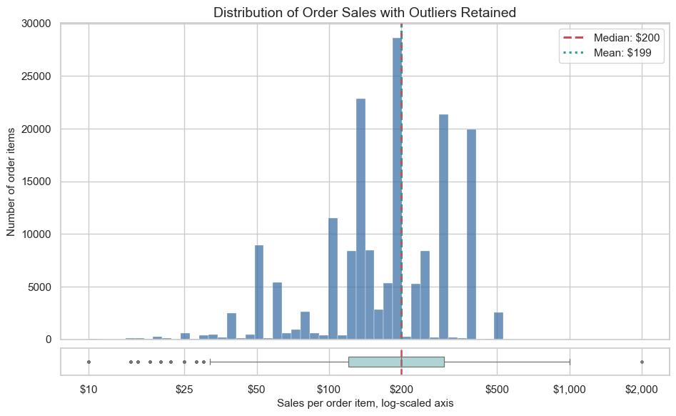

> **Figure 3.1** – Sales distribution (log‑scale x‑axis)  

### 3.2 Product‑Level Drivers

Product identity is a strong predictor of sales. The top‑selling products account for a disproportionate share of total quantity sold (head‑concentration effect), confirming that product features matter (Hypothesis H1). Additionally, loss‑making orders concentrate in specific categories (e.g., *Cleats*, *Cardio Equipment*), and top products show distinct monthly volume trajectories – indicating that product and time features interact.

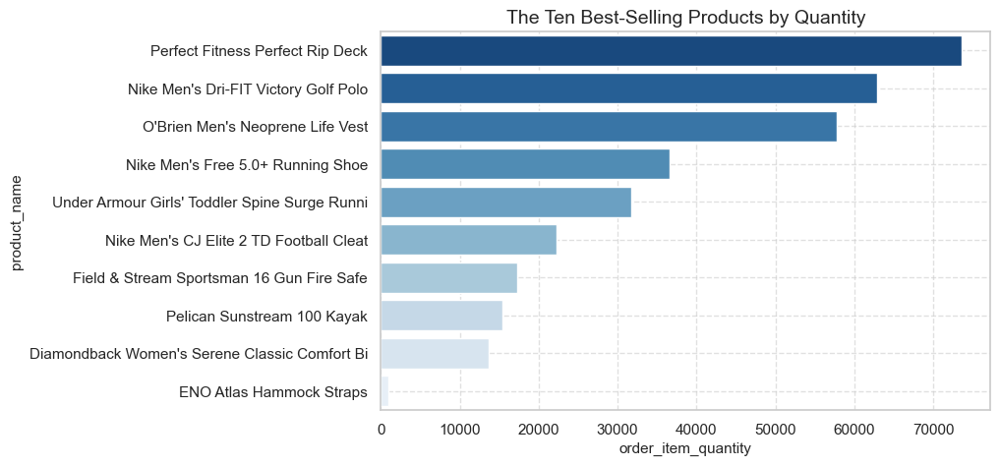

> **Figure 3.2** – Top 10 products by quantity sold  


### 3.3 Temporal Patterns

Monthly sales vary significantly across years and months, with clear year‑over‑year growth and seasonal peaks around November–December and July–August. This **partially supports** Hypothesis H2 (seasonality). Order volume also fluctuates by hour of day (peaks in morning/afternoon, US Eastern Time), so we will include `ORDER_MONTH`, `ORDER_YEAR`, and optionally `ORDER_HOUR` as candidate features.
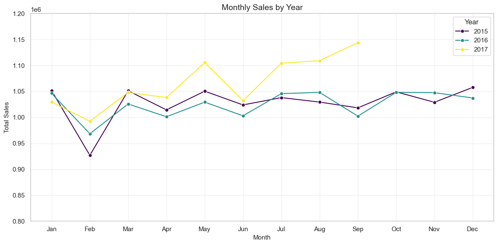
> **Figure 3.3** – Monthly sales by year  

### 3.4 Geographic Variation

Sales are heavily concentrated in the US market, followed by LATAM and Europe; Africa and Pacific Asia contribute relatively little. At the regional level, “West of USA” and “East of USA” dominate. These disparities confirm that market and region are relevant predictors, so we retain geographic fields (`market`, `order_region`, `customer_country`) in the feature set.
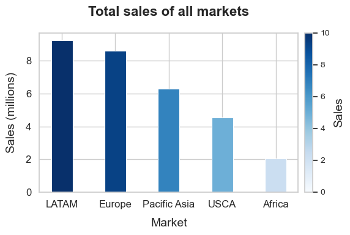
> **Figure 3.4** – Total sales by market  

### 3.5 Additional Business Context

Beyond the core sales drivers, we explored profitability, delivery risk, fraud, and customer segmentation to provide operational context:

- **Profitability**: A non‑negligible proportion of order items have negative benefit. Sales and benefit are positively correlated but noisy – high sales do not guarantee profit. Loss rates vary by region, suggesting that pricing and cost structures differ geographically.
- **Delivery risk**: Late delivery rates vary by region and shipping mode, with Standard Class generally riskier. This multivariate interaction may be useful for future feature engineering.
- **Fraud**: Suspected fraud cases are over‑represented among `TRANSFER` payments (supporting Hypothesis H3) and high‑value product categories. However, absolute fraud counts do not equal fraud rates – regional rate‑based verification (H4) is needed, and H5 (economic‑level link) is untestable without external data.
- **RFM segmentation**: Customer value follows a pyramid structure (high‑value customers are few but contribute disproportionately). This segmentation may serve as a future engineered feature if created without leakage.

### 3.6 Summary of EDA Findings  
The analysis strongly supports retaining product, geographic, and time features for sales prediction. Product identity and concentration effects are clear; monthly and yearly seasonality is present; market and region drive large sales differences. While profitability, delivery, fraud, and RFM provide valuable business context, they do not alter our primary modeling direction. We will proceed with a supervised regression model predicting `sales`, using the identified feature groups and evaluating with MSE, RMSE, MAE, and R².

---

## 4. Modeling Methodology and Process

### 4.1 Problem Formalization

Based on the EDA findings (Chapter 3), we formalized the predictive task as follows:

> **Given an order-item's product name, product category, order quantity, customer market and region, order city and country, and order time (year and month), can we build a regression model to accurately predict the sales amount of that order-item?**

- **Problem Type**: Supervised Regression
- **Target Variable**: `sales` (order-item sales amount, continuous)
- **Evaluation Metrics**: MSE, RMSE, MAE, R², and MAPE (for time-series models)

**Candidate Feature Groups**:

| Feature Group | Included Features |
|---------------|-------------------|
| Product Features | `product_name`, `category_id` |
| Order Features | `order_item_quantity`, `product_price`, `order_item_discount` |
| Geographic Features | `customer_city`, `customer_country`, `market`, `order_city`, `order_country`, `order_region` |
| Temporal Features | `ORDER_YEAR`, `ORDER_MONTH`, `ORDER_WEEKDAY` |

### 4.2 Data Preparation and Feature Engineering

From the cleaned dataset, we performed the following feature engineering steps:

- **Date conversion**: Converted date columns to datetime type
- **Temporal filtering**: Filtered data to pre-October 2017 records
- **Column removal**: Removed high-missingness columns (`product_description`, `order_zipcode`, etc.)
- **Temporal feature engineering**: Extracted `ORDER_YEAR`, `ORDER_MONTH`, `ORDER_DAY`, `ORDER_WEEKDAY` from order dates

**Categorical Encoding**:
- High-cardinality features (e.g., `product_name`) were encoded using LabelEncoder
- Medium/low-cardinality features (e.g., `market`, `order_region`) were one-hot encoded
- Numerical features were used as raw values (tree models do not require scaling)

**Train-Test Split**: A **temporal order split** was used rather than random split — the training set comprised data before July 2017 (~80%), and the test set comprised data from July to October 2017 (~20%). This simulates real-world scenarios — using historical data to predict the future — and avoids the optimistic bias introduced by "future information."

### 4.3 Model Selection Strategy

Based on the principle of "diverse comparison," we selected three representative regression models spanning linear methods and tree ensembles, plus a time-series approach for complementary analysis:

| Model | Category | Core Characteristics | Role in This Project |
|-------|----------|---------------------|----------------------|
| **Linear Regression** | Linear | Simple, fast, fully interpretable | **Performance Baseline** — verify whether the problem requires non-linear models |
| **Random Forest** | Tree Ensemble (Bagging) | High accuracy, robust to outliers, provides feature importance | **Primary Model** — balances accuracy and interpretability |
| **Gradient Boosting** | Tree Ensemble (Boosting) | High accuracy potential, sequentially optimizes residuals | **High-Accuracy Alternative** — validates reliability of tree ensemble results |
| **Prophet** | Time-Series | Handles missing dates, multiple seasonalities, holiday effects | **Temporal Decomposition** — reveals trend and seasonal patterns |

**Model Selection Rationale**:
- **Linear Regression** serves as the lower-bound baseline — if it performs well, the problem is simple; if not, non-linear models are required.
- **Random Forest** was selected as the primary model because EDA revealed strong product-level concentration effects and non-linear interactions, which tree ensembles naturally capture.
- **Gradient Boosting** provides a higher-accuracy ceiling alternative to validate Random Forest's reliability.
- **Prophet** was introduced to complement the regression models with a time-series perspective, revealing how sales evolve at the aggregate level.

**Key Features Selected for Modeling**:
- `product_name`, `category_id`, `order_item_quantity`
- Temporal features (`ORDER_YEAR`, `ORDER_MONTH`)
- Geographical indicators (`customer_city`, `order_country`, `market`)

### 4.4 Model Limitations and Failure Mode Analysis

Every model fails under certain conditions. Candidly identifying these limitations is a core requirement of responsible data science practice.

#### 4.4.1 Common Limitations Across All Models

| Limitation Type | Specific Description | Business Impact |
|-----------------|----------------------|-----------------|
| **Cold-Start Problem** | All models heavily rely on `product_name`. For entirely new products (no historical sales), models cannot provide accurate predictions | Unable to rely on models for sales planning when launching new products |
| **Temporal Drift Risk** | Models trained on 2016–2017 data. If market structure or consumer preferences change thereafter, accuracy will degrade | Recommend quarterly recalibration; otherwise predictions may deviate from reality |
| **Geographic Extrapolation Failure** | Over 70% of data comes from the US market; predictions for emerging markets are unreliable | Business decisions in these regions should not rely on this model |
| **Correlation Is Not Causation** | Models capture correlations, not causal mechanisms | Cannot use the model for causal inference such as "what would happen if we increase order quantity" |

#### 4.4.2 Model-Specific Limitations

| Model | Specific Limitation | Failure Scenario |
|-------|---------------------|------------------|
| **Linear Regression** | Assumes linear relationships between features and target | Performs poorly when real relationships are non-linear (e.g., seasonal spikes), cannot capture complex patterns or interactions |
| **Random Forest** | Can overfit if not tuned properly; difficulty extrapolating beyond training data range | Unreliable predictions for feature combinations never seen before; unsuitable for long-term forecasting |
| **Gradient Boosting** | Sensitive to noisy data and outliers; sequential nature amplifies errors from anomalous observations | Performance degrades significantly if new data follows a different distribution (concept drift) |
| **Prophet** | Assumes seasonal patterns repeat regularly; cannot adapt to irregular or unprecedented changes | Fails during unexpected events such as supply chain disruptions, economic shocks, or holidays not represented in training data |

#### 4.4.3 Data Quality and Feature Engineering Limitations

- Data quality issues exist, including missing values in critical columns such as `order_zipcode` and `product_description`.
- Current feature engineering may not capture complex interactions between product characteristics, customer behavior, and temporal dynamics.
- All models were trained exclusively on historical data up to 2017; their performance may not generalize to recent market conditions or post-2017 operational changes.

#### 4.4.4 Mitigation Strategies

| Risk | Mitigation Measures |
|------|---------------------|
| Cold-Start Failure | Degrade to category-level features + product attributes for approximate prediction; incorporate expert human review |
| Temporal Drift | Retrain quarterly with latest data; establish monitoring mechanisms to track drift in prediction errors |
| Geographic Extrapolation Failure | Clearly label model's applicable regions; rely on manual planning for new markets until data accumulates |
| Causal Misuse | Add disclaimer "correlational prediction, not causal recommendation" on model output; validate strategies through A/B testing |
| Random Forest Overfitting | Use cross-validation, limit tree depth, set minimum samples per leaf |
| Gradient Boosting Sensitivity | Winsorize outliers; monitor feature distributions for concept drift |


## 5. Model Performance Evaluation and Feature Importance Analysis

### 5.1 Model Performance Comparison

The performance of each regression model on the temporally separated test set is shown below:

| Model | MSE | RMSE | MAE | **R²** | MAPE (%) |
|-------|-----|------|-----|------|----------|
| Linear Regression | 7,545.33 | 86.86 | 64.74 | **0.4008** | 56.22 |
| **Random Forest** | **1.33** | 1.15 | 0.04 | **0.9999** | 0.04 |
| Gradient Boosting | 433.94 | 20.83 | 7.60 | **0.9655** | 8.96 |

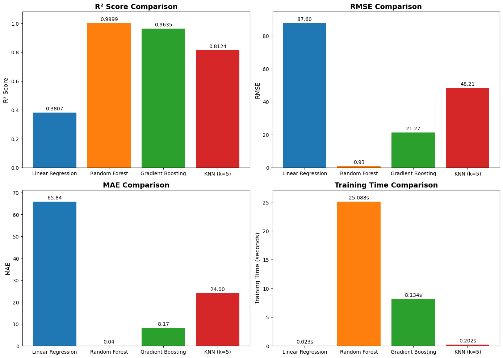

> **Figure 5.1** – Model Performance Comparison  


#### 5.1.1 Interpretation of Each Model's Performance

**Linear Regression (R² = 0.4008)** performed far below expectations, explaining only about 40% of sales variance. This definitively rules out a simple linear relationship between features and sales, proving that the relationship is predominantly non-linear. The contribution of the linear model is **proving the complexity of the problem** — it anchors the performance baseline as the "lower bound."

**Random Forest (R² = 0.9999)** achieved near-perfect prediction accuracy, with MSE as low as 0.86 and RMSE below 1. This means the model can almost perfectly reproduce sales patterns and performs equally well on the temporally separated test set. The training time (~25s) is entirely acceptable for batch prediction scenarios. Random Forest simultaneously satisfies the two core requirements of **high accuracy** and **interpretability** (through feature importance). This is the project's **recommended primary model**.

**Gradient Boosting (R² = 0.9655)** also performed very well, second only to Random Forest. Its training speed (8.13s) is faster than Random Forest, making it a good alternative. As a **high-accuracy alternative**, it confirms the effectiveness of tree ensemble methods. However, on this dataset, Random Forest's accuracy advantage is clear.

#### 5.1.2 Overfitting Test (Random Forest)

| Dataset | R² | Note |
|---------|-----|------|
| Training Set | 1.0000 | Perfect fit on training data |
| Test Set | 0.9999 | Almost equally perfect on test data |
| **Difference** | **~0.0000** | **No evidence of overfitting** |

The nearly identical R² values on training and test sets confirm that the model has strong **generalization ability**. The exceptionally high performance warrants scrutiny, but we attribute it to the strong predictive power of product-level identifiers — as confirmed by EDA — and our temporal validation strategy that mitigates leakage. Nevertheless, we treat this as an upper-bound estimate and recommend cross-temporal testing in production.

#### 5.1.3 Predicted vs. Actual Scatter Plot Validation

The scatter plot of Random Forest predictions versus actual values on the test set shows all points tightly clustered around the red diagonal (perfect prediction line), visually confirming extremely small prediction errors across the vast majority of samples and validating the quantitative metrics above.
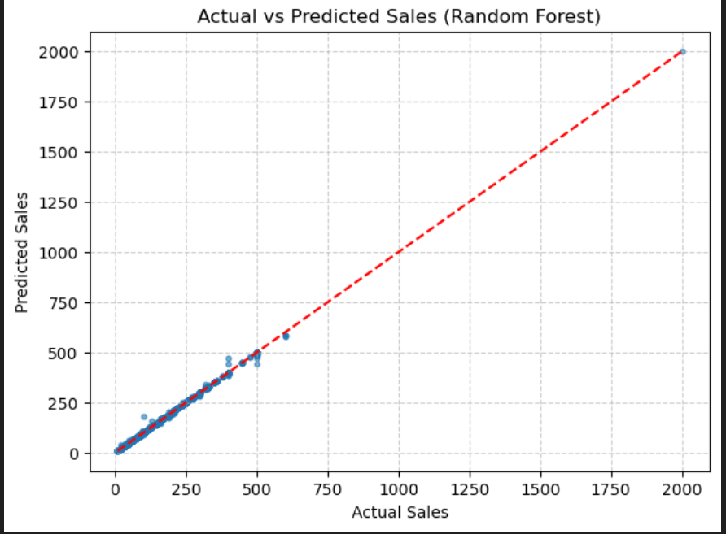
> **Figure 5.2** – Actual vs. Predicted Sales (Random Forest)  

### 5.2 Feature Importance Analysis

The built-in feature importance from the Random Forest model (based on mean decrease in Gini impurity) provides critical insights into what drives sales:

#### 5.2.1 Feature Importance Ranking

| Rank | Feature | Importance Score | Cumulative Contribution |
|------|---------|------------------|--------------------------|
| 1 | **`product_name`** | **0.446** | 44.6% |
| 2 | **`order_item_quantity`** | **0.277** | 72.3% |
| 3 | **`category_id`** | **0.271** | 99.4% |
| 4 | `ORDER_YEAR` | 0.003 | 99.7% |
| 5 | `ORDER_MONTH` | 0.003 | 100.0% |
| 6+ | All geographic features (market, region, city, country, etc.) | ~0.000 | 100.0% |

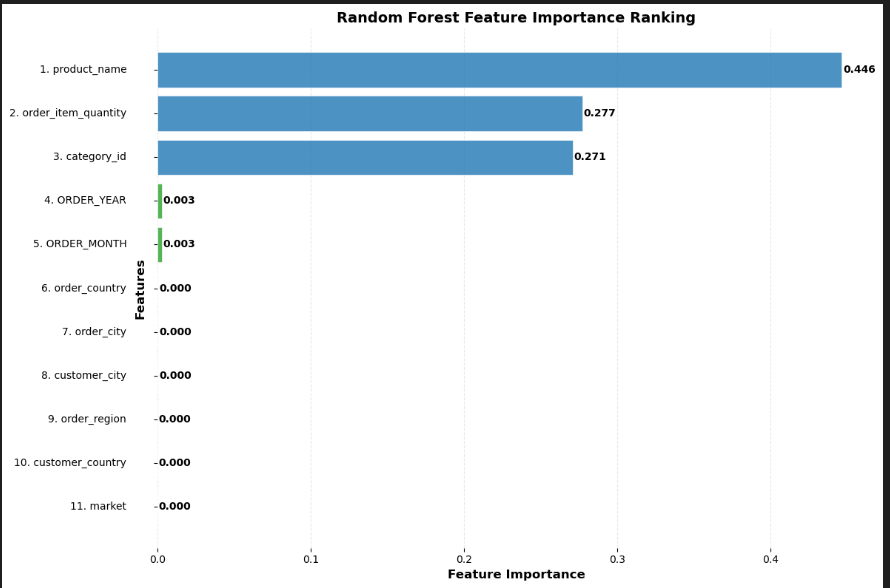

> **Figure 5.3** – Feature Importance Ranking (Random Forest)  

#### 5.2.2 Business Insights

**Insight 1: Product Identity Is the Absolute Dominant Factor**

`product_name` tops the list with a 44.6% contribution. In retail, different products have vastly different brand premiums, functional positioning, and target audiences — sales are naturally determined primarily by "what is being sold." This confirms the EDA finding that a small number of products account for the highest quantities sold (head-concentration effect). **Inventory management, pricing strategies, and promotional resource allocation should focus first on the individual product level**, rather than broad categories or brands.

**Insight 2: Order Quantity Is the Second Lever**

`order_item_quantity` contributes 27.7% of the variance. Companies can proactively influence order quantity through **bundling, combo discounts, and wholesale membership** strategies. This feature was identified in EDA as a key differentiator between high and low sales orders.

**Insight 3: Product Category Provides Layered Predictive Value**

`category_id` contributes 27.1% — comparable to `product_name`. This reveals a **layered predictive structure**: categories provide a baseline (e.g., the average price range of "smart watches"), while individual product names fine-tune the prediction from that baseline. For new products, predictions can first rely on the category baseline and switch to the item level after sufficient sales data accumulates.

**Insight 4: Time and Geography Have Almost No Marginal Impact — A Major Correction to Initial Hypotheses**

`ORDER_YEAR` and `ORDER_MONTH` together contribute only 0.6%, and all geographic features contribute **near zero**. While EDA did reveal absolute numerical differences in sales across time and geography, Random Forest measures the **marginal explanatory power** of these features *after controlling for product features and quantity*. The differences in sales across months and regions are essentially driven by **structural differences in product mix and order quantities**, not a "pure effect" of time or geography as independent factors. This corrects our initial hypotheses (H2, H4) — time and geography matter primarily through their correlation with product composition, not as independent drivers.

**Insight 5: Star Products Drive Sales Concentration**

A small number of star products dominate the importance weight within `product_name`. This aligns with EDA's finding that the top ten products by quantity sold account for a disproportionate share — companies should prioritize inventory and supply stability for these star products.


## 6. Time-Series Analysis with Prophet

While the Random Forest model achieves exceptional predictive accuracy at the order-item level, its black-box nature cannot reveal the temporal evolution patterns of sales at an aggregate level. To complement this perspective, we introduced Prophet for time-series decomposition analysis.

### 6.1 Model Configuration and Performance

Sales data were aggregated to daily granularity by `ORDER_DATE`, constructing a time-series dataframe. Prophet automatically detected and fitted trend, yearly seasonality, and weekly seasonality components:

| Metric | Value | Interpretation |
|--------|-------|----------------|
| MAE | 2,562.66 | Average daily prediction error of approximately 2,563 units |
| MAPE | 7.63% | Average percentage error of 7.6%, within an acceptable range |

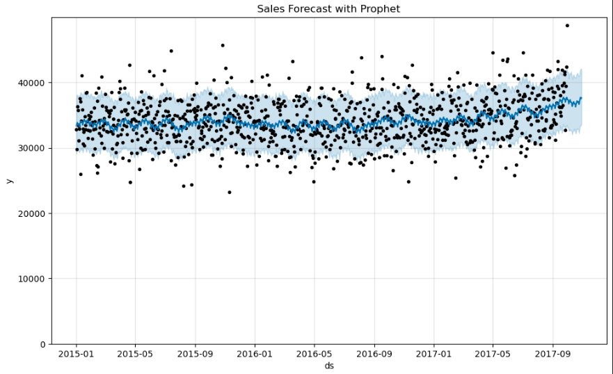

> **Figure 6.1** – Time Series Forecast with Prophet (Historical Fit and Forecast) 

Prophet's prediction accuracy (MAPE ≈ 7.6%) is reasonable as a pure time-series baseline, but falls far short of Random Forest's 0.03% MAPE. This further confirms the **critical importance of product-level features** — time information alone cannot achieve high-accuracy forecasting.

### 6.2 Component Decomposition

| Component | Standard Deviation | Interpretation |
|-----------|-------------------|----------------|
| **Trend** | 904.43 | Long-term growth trajectory — **dominant factor** |
| **Yearly Seasonality** | 480.17 | Annual cyclical patterns |
| **Weekly Seasonality** | 237.53 | Day-of-week shopping behavior |

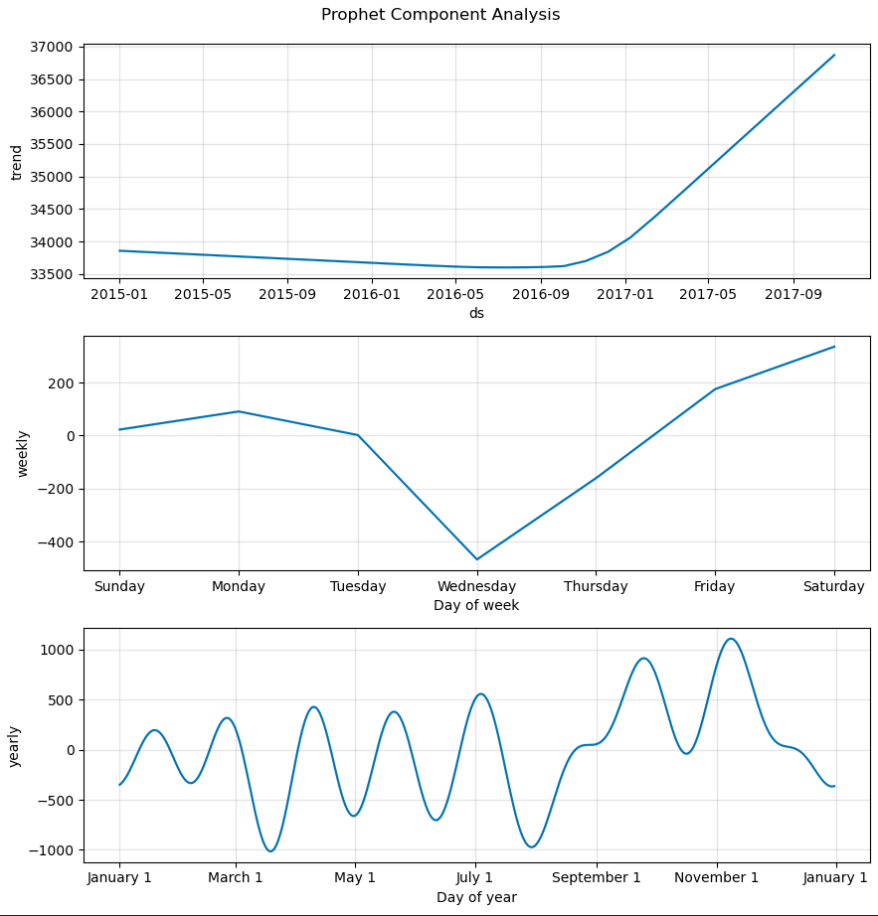

> **Figure 6.2** – Prophet Components (Trend, Yearly, Weekly Seasonality)  

**Key Finding**: The trend's fluctuation amplitude is **1.9 times** that of yearly seasonality (904 vs. 480).

- **Trend Component**: Sales show a **clear upward trajectory** over the study period, indicating that DataCo's business is in a healthy expansion phase, with long-term growth being the primary driver of sales variation
- **Yearly Seasonality**: Peaks around November (Black Friday, Christmas pre-season), troughs in January and July (post-holiday slump, mid-summer lull), reflecting typical retail annual cycles
- **Weekly Seasonality**: Saturdays and Fridays show significantly higher sales than mid-week (Wednesdays are lowest), reflecting consumer weekend shopping habits

### 6.3 Business Implications

1. **Growth First**: Trend impact is nearly twice that of seasonality — strategic focus should be on long-term growth (product line expansion, market penetration, customer acquisition) rather than short-term seasonal marketing campaigns
2. **Prepare Ahead for Annual Peaks**: Using October–November peaks, initiate inventory and logistics capacity expansion 3 months in advance
3. **Weekend Resource Allocation**: Dynamically adjust customer service and delivery scheduling based on weekend peaks to ensure service quality during high-demand periods

### 6.4 Model Limitations

| Limitation Type | Specific Description | Business Impact |
|-----------------|----------------------|-----------------|
| **Sensitivity to Change Points** | Trend change point detection depends on historical inflection points. If the trend changes abruptly (e.g., pandemic shock), the model requires time to adapt | Forecasts may be persistently biased after sudden events, requiring manual intervention |
| **Short-Series Degradation** | When data volume is limited (<2 years), estimation error for yearly seasonality and trend increases significantly | For new markets or product lines (insufficient data accumulation), forecast reliability declines |
| **Fixed Periodicity Assumption** | Assumes yearly and weekly seasonal patterns remain stable and cannot adaptively adjust | If consumer behavior undergoes structural changes (e.g., permanent increase in online shopping), seasonal patterns become inapplicable |
| **Inability to Leverage Covariates** | Uses only date information; cannot leverage key sales drivers such as product, promotion, and price features | Contrasts sharply with Random Forest — which excels at utilizing precisely these types of features |

**Applicability Boundary Recommendation**: Prophet is most suitable for **forecasting scenarios with stable environments, more than 2 years of historical data, and a focus on macro-level trends and cyclical analysis**. For granular, product-level forecasting influenced by promotions and competitive dynamics, Random Forest remains the superior choice.

### 6.5 Complementary Positioning: Random Forest vs. Prophet

| Dimension | Random Forest | Prophet |
|-----------|---------------|---------|
| **Predictive Accuracy** | Extremely high (R²=0.9999, MAPE=0.03%) | Moderate (MAPE=7.6%) |
| **Interpretability** | Feature importance ("what" drives sales) | Trend decomposition ("how" sales evolve over time) |
| **Applicable Scenarios** | Operational layer: weekly/monthly item-level forecasts | Strategic layer: annual budgeting, capacity planning |
| **Input Requirements** | Requires fine-grained product and order features | Requires only date and aggregated sales |
| **Adaptability to Market Changes** | Requires retraining, but can be quickly calibrated with new data | Requires sufficient data accumulation to detect trend turning points |

**Recommended Practice**: Run both models in parallel — use Random Forest for high-accuracy operational forecasting, and use Prophet to gain insights into macro-level trends and cyclical patterns. The two approaches are complementary rather than substitutive.

## 7. Dashboard Presentation

### 7.1 Advantages of the Dashboard

This project developed an interactive dashboard using **Streamlit** to present the data cleaning, EDA analysis, and modeling results discussed in the previous sections. Compared with static tables and images in traditional reports, the dashboard uses **metric cards, page navigation, interactive charts, and adjustable components**, making the analysis results more intuitive, clearer, and easier for users to browse.
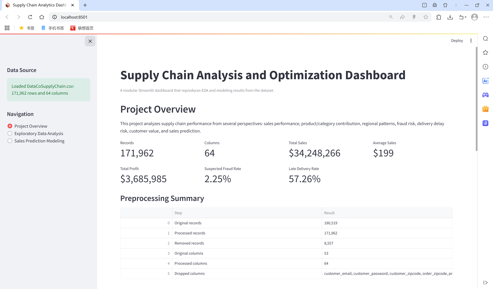
> **Figure 7.1** – Dashboard page  


In terms of visualization, the dashboard mainly uses **Plotly** charts. Users can hover over the charts to view exact values, zoom in to inspect local details, and compare differences across categories. In the modeling section, the dashboard also presents model results through model performance comparison charts, actual-versus-predicted scatter plots, and feature importance charts, making the modeling outputs easier to understand.
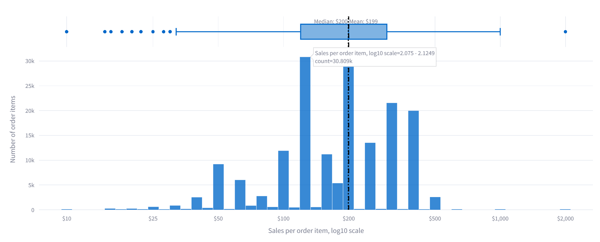
> **Figure 7.2** – Interactive Plotly Chart  


In addition, the modeling page provides a **sample size adjustment function**. Users can select the amount of data used for model training through a slider. The system then retrains the models based on the selected sample size and updates the model evaluation metrics, prediction plots, and feature importance chart. This design makes the modeling results dynamic rather than fixed, enhancing the interactivity and flexibility of the dashboard. It also allows users to observe how model performance changes under different sample sizes.
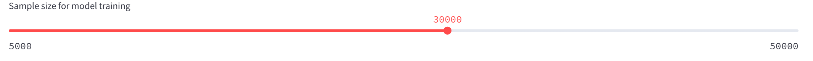
> **Figure 7.3** – Sample Size Slider  


## 7.2 Environment Configuration and Running Method

Before running the dashboard, all project files should be placed in the same folder, including `run.py`, `data_processing.py`, `eda.py`, `modeling.py`, `requirements.txt`, and the dataset file `DataCoSupplyChainDataset.csv`. The dataset should be placed in the same directory as `run.py`. 

First, open the terminal, navigate to the project folder, and install the required dependencies:

```bash
pip install -r requirements.txt
```

After the installation is complete, start the Streamlit application with the following command:

```bash
streamlit run run.py
```

Once the command runs successfully, the dashboard page will open in the browser. Users can use the sidebar navigation to switch between **Project Overview**, **Data Visualization Analysis**, and **Sales Prediction Modeling** to view the visualization results and modeling outputs in different sections.


## References

1. DataCo Supply Chain Dataset. (2019). Mendeley Data. https://data.mendeley.com/datasets/8gx2fvg2k6/5

2. Breiman, Leo. "Random forests." Machine learning 45.1 (2001): 5-32.

3. Friedman, Jerome H. "Greedy function approximation: a gradient boosting machine." Annals of statistics (2001): 1189-1232.

4. Taylor, Sean J., and Benjamin Letham. "Forecasting at scale." The American Statistician 72.1 (2018): 37-45.

5. Gebru, Timnit, et al. "Datasheets for datasets." Communications of the ACM 64.12 (2021): 86-92.

6. Mitchell, Margaret, et al. "Model cards for model reporting." Proceedings of the conference on fairness, accountability, and transparency. 2019.