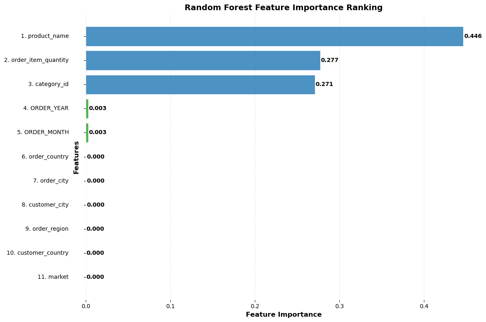
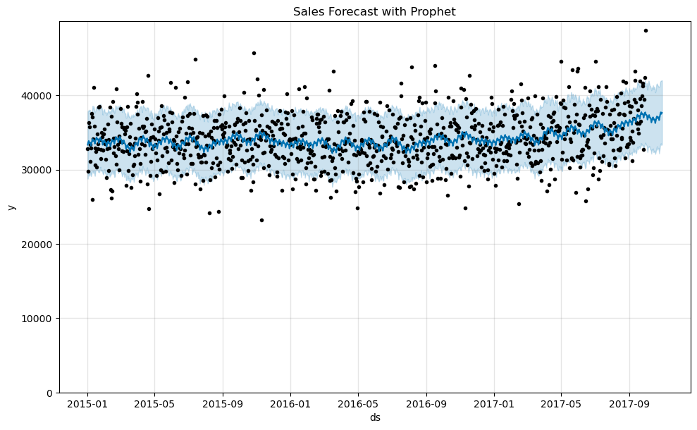

# Supply Chain Sales Prediction Model Card

## 1. Basic Model Information

This project builds a sales prediction model based on DataCo’s supply chain order data. The goal is to predict **order-level sales** and analyze the main factors that influence changes in sales. The model results are mainly used for **business analysis, sales trend assessment, and inventory operation reference**.

The project includes two types of models:

* **Order-level sales prediction models**: including Linear Regression, Random Forest Regressor, and Gradient Boosting Regressor, used to predict `sales` at the single-order or order-detail level.
* **Time series forecasting model**: using the Prophet model to predict future short-term sales trends based on daily sales.

In this project, we selected the **Random Forest model** as the main regression prediction model because it achieved the best performance, and selected the **Prophet model** as the main model for time series analysis.

## 2. Model Purpose

The order-level sales prediction model is used to estimate the possible sales amount of different orders under given conditions such as product, category, quantity, region, and time. This model can help analyze which factors have a greater impact on sales and provide reference for product strategy, inventory planning, and sales management.

The Prophet time series model is used to observe the overall sales trend. It can identify long-term trends, yearly seasonality, and weekly sales patterns, making it suitable for short-term sales planning and inventory preparation.

## 3. Model Inputs and Outputs

### 3.1 Order-Level Sales Prediction Model

**Input variables:**

* Product information: `product_name`, `category_id`
* Order information: `order_item_quantity`
* Regional information: `market`, `order_country`, `order_region`, `order_city`
* Customer regional information: `customer_country`, `customer_city`
* Time information: `ORDER_MONTH`, `ORDER_YEAR`

**Output variable:**

* `sales`: predicted order sales amount

### 3.2 Prophet Time Series Model

**Input variable:**

* Daily sales aggregated by date

**Output results:**

* Sales forecast values for the next 30 days
* Sales trend changes
* Yearly seasonality and weekly seasonality components

## 4. Model Methods

This project uses both **order-level regression models** and a **time series forecasting model**. The order-level regression models are used to predict `sales` at the single-order or order-detail level, focusing on the influence of product, category, quantity, region, and time features on sales. The Prophet time series model is used to analyze the overall trend of daily sales and forecast short-term future sales.

The models used in this project are shown below:

| Model                       | Type                      | Main Purpose                                                                                               |
| --------------------------- | ------------------------- | ---------------------------------------------------------------------------------------------------------- |
| Linear Regression           | Regression model          | Used as a baseline model for simple comparison                                                             |
| Random Forest Regressor     | Ensemble regression model | Used as the main order-level prediction model to capture non-linear relationships and feature interactions |
| Gradient Boosting Regressor | Ensemble regression model | Used as a comparison model to further evaluate the predictive performance of ensemble learning methods     |
| Prophet                     | Time series model         | Used to analyze sales trends and seasonality, and to forecast short-term future sales changes              |

### 4.1 Linear Regression

Linear Regression is the baseline model. It assumes that there is mainly a **linear relationship** between input features and sales. Its advantages are simple structure, fast training speed, and relatively easy interpretation. Therefore, it can be used to determine whether a simple linear method is sufficient to explain changes in order sales.

However, supply chain sales are usually affected by multiple factors such as product, quantity, region, and time, and the relationships between variables may be non-linear. Therefore, Linear Regression is mainly used in this project as a basic reference to evaluate whether more complex models bring significant improvements in predictive performance.

### 4.2 Random Forest Regressor

Random Forest Regressor is the main order-level sales prediction model in this project. It consists of multiple decision trees and obtains the final prediction by averaging the prediction results of these trees. Compared with a single decision tree, Random Forest can reduce model instability and better handle **non-linear relationships and feature interactions**.

At the same time, this model can output **feature importance**, which helps explain which variables contribute more to sales prediction. Since the dataset in this project contains multi-dimensional features such as product, category, quantity, region, and time, Random Forest is more suitable for capturing the complex relationships among these features.

### 4.3 Gradient Boosting Regressor

Gradient Boosting Regressor is also an ensemble learning model. Unlike Random Forest, which builds multiple trees in parallel, Gradient Boosting trains multiple weak learners step by step and continuously fits the residuals of the previous model to improve prediction performance.

This model can capture relatively complex data patterns. Therefore, it is used as a comparison model in this project to evaluate the performance of different ensemble learning methods in the sales prediction task.

### 4.4 Prophet

Prophet is a model used for time series forecasting and is suitable for data with trends and seasonal patterns. In this project, order sales are aggregated into a daily sales series by date, and Prophet is then used to model long-term trends, yearly seasonality, and weekly seasonality, as well as to forecast sales changes for the next 30 days.

Unlike order-level regression models, Prophet focuses on the overall change in sales over time. Therefore, it is mainly used to supplement the order-level model and help understand sales trends and periodic patterns.

## 5. Model Performance

### 5.1 Regression Models

According to the current project results, the evaluation metrics of each model in the order-level sales prediction task are as follows:

| Model             | MSE      | RMSE  | MAE   | **R²**     | MAPE (%) |
| ----------------- | -------- | ----- | ----- | ---------- | -------- |
| Linear Regression | 7,545.33 | 86.86 | 64.74 | **0.4008** | 56.22    |
| **Random Forest** | **1.33** | 1.15  | 0.04  | **0.9999** | 0.04     |
| Gradient Boosting | 433.94   | 20.83 | 7.60  | **0.9655** | 8.96     |

From the model evaluation results, **Random Forest** performs the best among the three order-level sales prediction models. Its R² reaches **0.9999**, and its MSE, RMSE, MAE, and MAPE are all the lowest, indicating that its predicted values are the closest to the actual sales values. In contrast, Linear Regression has an R² of only **0.4008**, suggesting that a simple linear model cannot fully explain the variation in sales. Gradient Boosting performs significantly better than Linear Regression, but its overall error is still higher than that of Random Forest.

Random Forest performs well because it can handle **non-linear relationships and complex feature interactions**. Supply chain order sales are usually not determined by a single variable in a linear way, but are jointly influenced by multiple factors such as product, category, purchase quantity, region, and time. Random Forest builds multiple decision trees and averages their prediction results, which can reduce the instability of a single tree and improve the model’s robustness and generalization ability. Therefore, it is more suitable for this type of tabular data prediction task with multiple feature types.

**Figure 1. Random Forest Feature Importance**

The figure shows the feature importance results of the Random Forest model, which further explains why Random Forest performs well. The variables with higher contribution mainly include `product_name`, `category_id`, and `order_item_quantity`. These variables have strong business relevance to order sales: different products and categories have different price levels, while purchase quantity directly affects the order sales amount. Therefore, Random Forest can use these key features for multiple splits and capture changes in sales more accurately.

This also indicates that, in the current dataset, order-level sales are mainly affected by **specific products, product categories, and purchase quantity**. In contrast, time variables and geographic variables have relatively lower importance in the model, suggesting that they contribute less to this order-level sales prediction task.

### 5.2 Prophet Time Series Model

This project uses Prophet to forecast daily sales aggregated by date. The model output includes historical fitted trends, future short-term forecast values, and prediction uncertainty intervals.

**Figure 2. Sales Forecast with Prophet**

From the forecast result, the black dots represent the actual daily sales, the blue curve represents the sales trend fitted and forecast by the Prophet model, and the light blue area represents the prediction uncertainty interval. Overall, the model is able to capture the main trend of sales changes. From 2015 to 2016, sales remained relatively stable. Starting from 2017, the model shows a gradually increasing sales trend, indicating signs of sales growth in the later period. The forecast interval becomes wider in the future period, which means that uncertainty increases as the forecast horizon becomes longer.

Therefore, the Prophet model is more suitable for observing the overall sales trend and short-term sales movement, rather than predicting single-order sales. It can serve as a supplement to the order-level Random Forest model and help understand the overall pattern of sales changes over time.

## 6. Streamlit Visualization Display

This project uses Streamlit to integrate the model functions into an interactive page, making it convenient for users to load data, view model training results, prediction performance, and feature importance. The purpose of this page is to visualize the model analysis process and results, reduce the complexity of manually running modeling steps, and help users understand model performance and prediction results more intuitively.

On the modeling page, users can view the evaluation metrics of different models, model performance comparison charts, actual-versus-predicted scatter plots, and feature importance charts. In addition, the page provides a sample size adjustment function. Users can adjust the amount of data used for model training through a slider and observe how the model results change under different sample sizes.

## 7. Usage

When using the order-level sales prediction model, the input data should first be preprocessed in the same way as during training, including field cleaning, date conversion, time feature construction, categorical variable encoding, and numerical standardization. The processed features are then input into the model to obtain the predicted sales value.

When using the Prophet model, order sales should first be aggregated into a daily sales series by date, and then input into Prophet for training and forecasting. The model outputs the sales forecast for the next 30 days and displays the trend, yearly seasonality, and weekly seasonality.

The recommended usage is as follows:

* Use Random Forest for **order-level sales prediction** and **feature importance analysis**.
* Use Prophet to observe the **overall sales trend** and **short-term sales changes**.
* Use the model results as business analysis references and interpret them together with actual inventory, promotion, and operational context.

## 8. Model Limitations

Although the models perform well in the current experiment, their results should still be used as **supporting analytical references**, rather than directly for automated business decision-making. The main limitations are as follows:

* **Cold-start problem**: The models rely heavily on historical features such as `product_name`, `category_id`, and `order_item_quantity`. Therefore, predictions may be unstable for new products, new categories, or new order combinations that have never appeared before.

* **Temporal drift risk**: The models are trained on historical order data. If the future market environment, consumer preferences, pricing strategies, or supply chain operations change, model accuracy may decline. Therefore, the models need to be retrained regularly with new data.

* **Limited generalization ability**: Random Forest and Gradient Boosting are more reliable for products and order patterns already present in the training data, but they may perform poorly for new regions, new markets, or feature combinations not seen in the training set.

* **Correlation does not equal causation**: The models reflect correlations in historical data and cannot directly explain causal effects. For example, high feature importance does not mean that changing that variable will necessarily lead to corresponding sales changes.

* **Prophet is sensitive to unexpected events**: Prophet assumes that historical trends and seasonality will continue. Therefore, forecasts may fail under supply chain disruptions, sudden promotions, sharp price changes, or special holidays.

Therefore, in practical use, model results should be combined with inventory conditions, promotion strategies, market environment, and human experience. Model performance should also be continuously monitored and updated regularly.

## 9. Conclusion

The models in this project can effectively support supply chain sales prediction and trend analysis. The order-level Random Forest model is suitable for sales prediction and key factor interpretation, while the Prophet model is suitable for short-term sales trend and seasonality observation.

Overall, the model results show that sales are mainly influenced by product, category, and purchase quantity, and can provide supporting references for sales analysis, inventory planning, and operations management. However, in practical use, attention should still be paid to the model’s dependence on historical data, limitations in generalization ability, and prediction risks under abnormal business scenarios.
