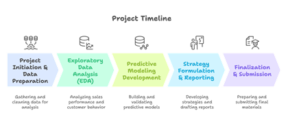

#### INFO 442 Data Science Projects
# Smart Supply Chain Analysis and Prediction Improvement
# Project Proposal

> Group Number: 19  
> Date: May 11th, 2026

### Members

| English Name| Chinese Name | Student ID |
|---|---|---|
| Ruohan Si | 司若菡|320230942290 |
| Zhuoyang Yu | 于卓扬|320230942650 |
| Aoqi Cui | 崔傲棋|320230941760 |
| Feixuan Yan | 闫菲烜|320230942850 |

---

# Table of Contents

- [Smart Supply Chain Analysis and Prediction Improvement](#smart-supply-chain-analysis-and-prediction-improvement)
- [Project Proposal](#project-proposal)
    - [Members](#members)
- [Table of Contents](#table-of-contents)
- [1. Domain and Motivation](#1-domain-and-motivation)
- [2. Dataset Description](#2-dataset-description)
- [3. Scientific Question](#3-scientific-question)
- [4. Preliminary Research Hypothesis](#4-preliminary-research-hypothesis)
- [5. Research Approach and Technical Flow](#5-research-approach-and-technical-flow)
  - [5.1 Process](#51-process)
  - [5.2 Tool Stack](#52-tool-stack)
- [6. Team Roles and Responsibilities](#6-team-roles-and-responsibilities)
- [7. Project Feasibility and Plan](#7-project-feasibility-and-plan)
  - [7.1 Project Feasibility](#71-project-feasibility)
  - [7.2 Timeline](#72-timeline)

---

# 1. Domain and Motivation

Supply chain management plays an important role in improving business efficiency and customer satisfaction. However, problems such as delivery delays, inventory imbalance, and inaccurate demand forecasting still affect enterprise operations. This project uses data analysis and modeling methods to analyze DataCo’s supply chain dataset and provide data-driven insights for supply chain optimization.

---

# 2. Dataset Description

The project uses the public **DataCo Supply Chain Dataset**, which contains **180,519 transaction records**. The dataset includes information about orders, logistics, products, customers, and finance.
The main features of this dataset include:

- **Time dimension**: order date, shipping date.

- **Logistics dimension**: scheduled shipping days, actual shipping days, shipping mode, delivery status, late delivery risk indicator.

- **Financial dimension**: order sales amount, discount, profit margin, profit per order.

- **Product dimension**: product category, product name, product price.

- **Customer and geographic dimension**: customer segment, city/country, market/region of order placement.

- **Order status dimension**: order status.

Dataset Link: https://data.mendeley.com/datasets/8gx2fvg2k6/5

---

# 3. Scientific Question

This project aims to address several important scientific and practical research questions in supply chain management through data mining and machine learning techniques.

First, the project investigates how different operational factors influence delivery delays and logistics risks. By analyzing transportation modes, shipping durations, geographic regions, and order characteristics, the study seeks to identify the key drivers of late deliveries and operational inefficiencies.

Second, the project explores customer purchasing behavior and market trends. Through customer segmentation and sales pattern analysis, the research aims to understand how customer groups differ in purchasing preferences, profitability, and seasonal demand changes. These findings can support targeted marketing strategies and improve customer relationship management.

Third, the project focuses on demand forecasting and predictive analytics. By applying machine learning models such as linear regression, decision trees, random forests, and time-series forecasting methods, the study attempts to improve the accuracy of sales and order quantity predictions, thereby helping businesses optimize inventory allocation and reduce operational costs.

Finally, the project examines supply chain optimization from a holistic perspective. By combining exploratory data analysis, correlation analysis, feature engineering, and predictive modeling, the research aims to build a comprehensive analytical framework for intelligent supply chain management. The final objective is to transform operational data into practical business insights and provide data-supported strategies for improving efficiency, reducing risks, and enhancing overall supply chain performance.

---

# 4. Preliminary Research Hypothesis

We have observed that in product-driven businesses, there is significant variation in product categories, and the security of transfer payments is low. Western Europe and Central America are high-fraud areas.

Team expectations: Product features have a significant impact on sales, and sales may exhibit seasonal distribution. The fraud rate may be related to the economic level of geographic regions and payment methods. In the future, we will verify or falsify the above conjectures through random forest feature importance analysis, regional comparison of fraud rates, and RFM stratification.

---

# 5. Research Approach and Technical Flow

## 5.1 Process

```text
Data Cleaning
    ↓
Time Feature Extraction
    ↓
EDA Multidimensional Analysis
    ↓
Modeling and Evaluation
    ↓
Prophet Forecasting
    ↓
Visualization Output
```


## 5.2 Tool Stack

- Python + Pandas + NumPy for Data Processing
- Matplotlib/Seaborn/Geopandas for Visualization
- Scikit-learn for Building Random Forest, Gradient Boosting, and Linear Regression Models for Comparison
- Prophet for Time Series Forecasting. Random Forest is used for Sales Regression, Prophet for Trend Forecasting, and the Two Models Complement Each Other in Evaluation.


---

# 6. Team Roles and Responsibilities

| Member | Student ID | Core Responsibilities |
|---|---|---|
| Ruohan Si | 320230942290 | Data engineering, preprocessing, feature engineering, and exploratory analysis |
| Zhuoyang Yu | 320230942650 | Customer behavior analysis, RFM modeling, fraud analysis, visualization |
| Aoqi Cui | 320230941760 | Predictive model development and forecasting |
| Feixuan Yan | 320230942850 | Model optimization, report writing, PPT creation, and strategy formulation |

---

# 7. Project Feasibility and Plan

## 7.1 Project Feasibility

**Data Availability**：The project uses a publicly available and well-documented supply chain dataset from DataCo, ensuring reliable and immediate access to the necessary data.

**Technical Maturity**：The analysis will employ a standard and proven data science technology stack (Python, Pandas, Scikit-learn). These tools are widely used, with extensive community support, making the proposed methods manageable.

**Structured Workflow**：The work is broken down into a clear plan with defined phases for data preparation, analysis, modeling, and reporting. This structured approach ensures all deliverables can be completed on time.

---

## 7.2 Timeline

Below is our project timeline:

